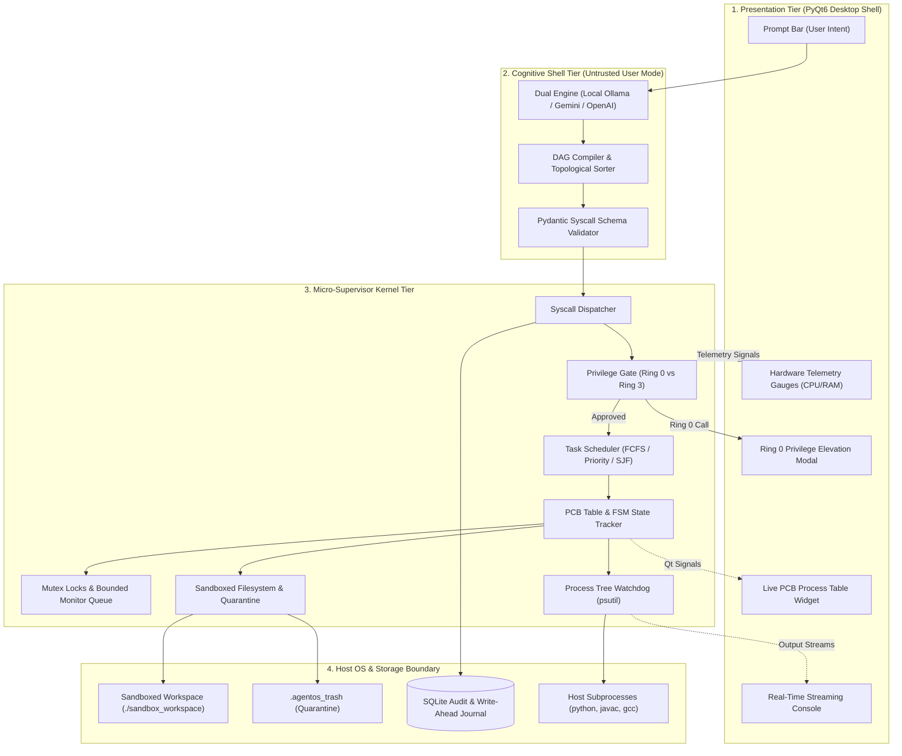

# AgentOS: Master Architecture, OS Concepts & Technical Defense Guide

> **Academic Project Reference & Technical Handbook**  
> **Project:** AgentOS — Cognitive User-Space Micro-Supervisor  
> **Target Audience:** Project Candidates, Evaluators, Technical Interviewers, and Systems Engineers  
> **Primary Technologies:** Python 3.11+, PyQt6, psutil, SQLite3, Pydantic v2, Ollama / Cloud LLMs  

---

## Table of Contents

- [Chapter 1: The Master Prompt (Universal Project Interrogator)](#chapter-1-the-master-prompt-universal-project-interrogator)
- [Chapter 2: Executive Presentation & Architectural Blueprint](#chapter-2-executive-presentation--architectural-blueprint)
  - [2.1 The 30-Second Elevator Pitch](#21-the-30-second-elevator-pitch)
  - [2.2 The Fundamental Problem of Raw LLM Execution](#22-the-fundamental-problem-of-raw-llm-execution)
  - [2.3 Three-Tier Decoupled Architecture](#23-three-tier-decoupled-architecture)
  - [2.4 End-to-End Request-to-Execution Lifecycle](#24-end-to-end-request-to-execution-lifecycle)
- [Chapter 3: Deep-Dive Mapping of Classic Operating Systems Concepts](#chapter-3-deep-dive-mapping-of-classic-operating-systems-concepts)
  - [3.1 Command Interpreter / Shell (Cognitive Agent Shell)](#31-command-interpreter--shell-cognitive-agent-shell)
  - [3.2 Dual-Mode Operation & Hardware Privilege Rings (Ring 0 vs. Ring 3)](#32-dual-mode-operation--hardware-privilege-rings-ring-0-vs-ring-3)
  - [3.3 Process Control Block (PCB) & 5-State Finite State Machine](#33-process-control-block-pcb--5-state-finite-state-machine)
  - [3.4 CPU Scheduling Algorithms & Policy Engine](#34-cpu-scheduling-algorithms--policy-engine)
  - [3.5 The Convoy Effect & Empirical Benchmarking](#35-the-convoy-effect--empirical-benchmarking)
  - [3.6 Concurrency, Critical Sections & Synchronization Primitives](#36-concurrency-critical-sections--synchronization-primitives)
  - [3.7 Process Supervision, Watchdog Timers & Zombie Eradication](#37-process-supervision-watchdog-timers--zombie-eradication)
  - [3.8 Virtualized Filesystem, Canonical Sandboxing & Path Jail](#38-virtualized-filesystem-canonical-sandboxing--path-jail)
  - [3.9 Write-Ahead Transaction Logging & 1-Click Disaster Rollback](#39-write-ahead-transaction-logging--1-click-disaster-rollback)
  - [3.10 Hardware Telemetry & Non-Blocking Resource Accounting](#310-hardware-telemetry--non-blocking-resource-accounting)
- [Chapter 4: Comprehensive Edge Cases Handled in the System](#chapter-4-comprehensive-edge-cases-handled-in-the-system)
  - [4.1 Security & Protection Boundaries](#41-security--protection-boundaries)
  - [4.2 Concurrency & Thread Synchronization](#42-concurrency--thread-synchronization)
  - [4.3 Process Supervision & Child Process Trees](#43-process-supervision--child-process-trees)
  - [4.4 Task Scheduling & DAG Plan Validation](#44-task-scheduling--dag-plan-validation)
  - [4.5 Filesystem Integrity & Disaster Rollback](#45-filesystem-integrity--disaster-rollback)
  - [4.6 LLM Reliability & Network Independence](#46-llm-reliability--network-independence)
- [Chapter 5: Master Viva Examination & Technical Defense Q&A Bank](#chapter-5-master-viva-examination--technical-defense-qa-bank)
  - [5.1 Section A: Core Architecture & OS Foundations](#51-section-a-core-architecture--os-foundations)
  - [5.2 Section B: Concurrency, Threading & Memory](#52-section-b-concurrency-threading--memory)
  - [5.3 Section C: Security, Sandboxing & Storage](#53-section-c-security-sandboxing--storage)
  - [5.4 Section D: Tricky & Trap Questions for Defense](#54-section-d-tricky--trap-questions-for-defense)
- [Chapter 6: Codebase Navigation & Implementation Reference Matrix](#chapter-6-codebase-navigation--implementation-reference-matrix)

---

# Chapter 1: The Master Prompt (Universal Project Interrogator)

*Use this master prompt in any AI model, code review system, or evaluation tool to analyze, explain, or present AgentOS:*

```markdown
You are a Principal Operating Systems Engineer and Academic Project Evaluator. 
Your goal is to thoroughly analyze, explain, and evaluate the codebase of "AgentOS: A Cognitive User-Space Micro-Supervisor".

CONTEXT & ARCHITECTURAL FOUNDATION:
AgentOS is NOT a standard AI wrapper script that pipes strings into bash. It is an operating systems project implemented in Python (PyQt6, psutil, SQLite) that treats Large Language Models (LLMs) as an untrusted, user-space Command Interpreter (Shell) and introduces an in-memory Micro-Supervisor Kernel to govern execution.

Analyze and explain the project across the following 5 dimensions:

1. CORE OS CONCEPT MAPPING:
   Map classic Operating Systems principles (Silberschatz, Galvin & Gagne) to their concrete software implementations:
   - Command Interpreter / Shell -> LLM Planner (agent/planner.py)
   - Dual-Mode Privilege Rings -> Ring 0 vs Ring 3 (security/privilege.py, ui/elevation_dialog.py)
   - Process Control Block (PCB) -> TaskPCB 5-state machine (kernel/pcb.py)
   - CPU Task Scheduling -> FCFS, Priority, SJF, and the Convoy Effect (kernel/scheduler.py, benchmark_scheduler.py)
   - Concurrency & Critical Sections -> Mutex locks, Monitor/Condition Variables Bounded Queue (kernel/sync.py)
   - Process Supervision & Zombie Elimination -> psutil recursive tree killing & watchdogs (kernel/process_manager.py)
   - Virtualized Filesystem & Recovery -> Canonical Path Jail & SQLite Write-Ahead Undo Journal (security/sandbox.py, storage/journal.py)
   - Resource Telemetry -> Non-blocking CPU per-core & RAM polling (kernel/telemetry.py)

2. EXECUTION LIFECYCLE:
   Trace the step-by-step lifecycle of an instruction:
   User Input -> LLM Plan Compilation (Syscall DAG) -> Ring 0/Ring 3 Privilege Gate -> PCB Creation (NEW -> READY) -> Ready Queue Dispatch (FCFS/Priority/SJF) -> Supervised Worker Thread -> Process Watchdog & Telemetry -> SQLite Audit & Real-Time PyQt6 UI Update.

3. EDGE CASES & DEFENSE-IN-DEPTH:
   Identify all security, concurrency, and reliability safeguards:
   - Canonical path traversal prevention (`../../`, Windows drive letters, symlinks)
   - Prohibited shell wrapper prefixes (`cmd.exe /c`, `sh -c`, `powershell -command`)
   - Runaway loops (`while True`) and hard timeouts (SIGTERM -> recursive tree SIGKILL)
   - Orphaned zombie child processes prevention via `proc.children(recursive=True)`
   - Safe numeric AST calculator blocking code injection (`__import__('os')`)
   - URL schema sanitization (blocking `file:///`, `javascript:`)
   - DAG cycle detection (self-dependencies, 2-node and 3-node cycles)
   - Transactional rollback from `.agentos_trash` with timestamped UUIDs
   - UI thread isolation via PyQt6 QThread and Qt Signals.

4. ACADEMIC & VIVA PREPARATION:
   Provide an exhaustive examiner question bank with rigorous answers:
   - "Why is this an OS project and not an AI script?"
   - "Explain the Convoy Effect and how your SJF implementation reduces waiting time by 73%."
   - "How did you solve the Critical Section problem on shared state?"
   - "What happens if a child process spawns 10 background worker processes before timing out?"
   - "How do you prevent malicious prompts from deleting host files?"

Present the output with clear architecture diagrams, tabular comparisons, mathematical formulas for scheduling metrics, and concrete code references.
```

---

# Chapter 2: Executive Presentation & Architectural Blueprint

## 2.1 The 30-Second Elevator Pitch
> *"Traditional AI agents like AutoGPT or LangChain blindly pipe model predictions into system shells like `bash` or `cmd.exe`. If the model hallucinates or receives a prompt injection, it can delete host files, escape directories, or spawn runaway background loops that lock the entire system.
> 
> **AgentOS** solves this by implementing classical Operating System principles in user space. The LLM is demoted to an untrusted **Command Interpreter (Shell)**. Every action is compiled into a typed **System Call**, tracked in a **Process Control Block (PCB)**, sequenced by a **Deterministic Scheduler (FCFS, Priority, SJF)**, protected by a **Dual-Mode Privilege Ring (Ring 0 vs. Ring 3)**, and supervised by a **Process Watchdog** with recursive tree termination and 1-click disaster rollback."*

---

## 2.2 The Fundamental Problem of Raw LLM Execution

```
+-----------------------------------------------------------------------------------+
|  TRADITIONAL OS:   User ---> Shell (bash/sh) ----> Syscalls ----> Kernel ---> HW  |
|  NAIVE AI WRAPPER: User ---> LLM -------------> raw shell (cmd/bash) -------> CRASH/BREACH
|  AGENTOS MODEL:    User ---> LLM Shell (Ring 3) -> Syscalls ----> Kernel ---> OS  |
+-----------------------------------------------------------------------------------+
```

Connecting Large Language Models directly to a host shell introduces critical hazards:
1. **Unbounded Privilege Escalation:** Without privilege rings, a model can execute destructive operations (`rm -rf`, disk wipes, system file alteration) without human consent.
2. **Directory & Sandbox Escapes:** Relative traversal attacks (`../../Windows/System32` or `../../../../etc/shadow`) bypass application boundaries.
3. **Runaway Process Starvation:** Code containing infinite loops (`while True: pass`) or deadlocks permanently hijacks CPU cores.
4. **Loss of Concurrency & Observability:** The user cannot observe intermediate states, inspect queues, or track resource footprints.
5. **Absence of Reversibility:** File deletions are permanent, causing immediate data loss upon errors.

---

## 2.3 Three-Tier Decoupled Architecture



---

## 2.4 End-to-End Request-to-Execution Lifecycle

1. **Submission:** The user enters a natural language goal:  
   *“Find the Java file in my workspace, compile it, and run it with a 5s timeout.”*
2. **Cognitive Decomposition:** The Cognitive Layer decomposes this into a Directed Acyclic Graph (DAG) of typed system calls:
   - Step 1: `sys_file_search(pattern="*.java")`
   - Step 2: `sys_proc_spawn(cmd=["javac", "HelloWorld.java"])` (depends on Step 1)
   - Step 3: `sys_proc_spawn(cmd=["java", "HelloWorld"], timeout=5)` (depends on Step 2)
3. **Privilege & Sandbox Check:** Each call is evaluated by `PrivilegeGate` and `validate_safe_path`:
   - Step 1 is classified as **Ring 3 (Safe / Read-only)** $\rightarrow$ Auto-approved.
   - Steps 2 & 3 are classified as **Ring 0 (Privileged / Execution)** $\rightarrow$ Interactive elevation modal prompts user for explicit consent.
4. **PCB Instantiation & Scheduling:** Each approved task is wrapped in a `TaskPCB`, assigned a unique PID and priority, transitioned from `NEW` $\rightarrow$ `READY`, and placed in the ready queue.
5. **Supervised Execution:** The `SupervisorWorker` thread dequeues the highest-priority task according to the selected policy (**FCFS, Priority, or SJF**). State transitions from `READY` $\rightarrow$ `RUNNING`.
6. **Watchdog Verification:** The background `ProcessWatchdog` monitors the execution tree via `psutil`. If an infinite loop or hanging process exceeds the timeout, the watchdog halts the descendant tree recursively.
7. **Telemetry & Audit:** Metrics (CPU time, peak RAM, exit code) update in the PCB table, stream to the PyQt6 dashboard, and persist permanently to the SQLite write-ahead log.

---

# Chapter 3: Deep-Dive Mapping of Classic Operating Systems Concepts

AgentOS translates standard Operating Systems textbook topics (*Silberschatz, Galvin & Gagne*) into concrete software modules:

```
+-----------------------------------------------------------------------------------+
|  TEXTBOOK CONCEPT                   AGENTOS COMPONENT                             |
|  Command Interpreter (Shell)   -->  agent/planner.py & agent/prompts.py           |
|  Dual-Mode Privilege Rings    -->  security/privilege.py & ui/elevation_dialog.py|
|  Process Control Block (PCB)   -->  kernel/pcb.py (TaskPCB Class)                 |
|  Process State Machine         -->  NEW -> READY -> RUNNING -> WAITING -> TERM    |
|  CPU Scheduling Policies       -->  kernel/scheduler.py (FCFS / Priority / SJF)  |
|  The Convoy Effect             -->  benchmark_scheduler.py                       |
|  Process Synchronization       -->  kernel/sync.py (Mutexes & Monitor Queue)      |
|  Process Supervision/Watchdog  -->  kernel/process_manager.py (psutil Tree Kill)  |
|  Filesystem Sandboxing         -->  security/sandbox.py (Canonical Path Jail)    |
|  Write-Ahead Journal / Undo    -->  storage/journal.py & kernel/file_engine.py    |
|  Resource Telemetry            -->  kernel/telemetry.py & ui/telemetry_widget.py |
+-----------------------------------------------------------------------------------+
```

---

## 3.1 Command Interpreter / Shell (Cognitive Agent Shell)
- **Theoretical Basis:** The command interpreter (shell) acts as the primary interface between user intentions and kernel system calls, parsing commands, checking syntax, and formulating requests for the supervisor.
- **AgentOS Implementation:** [`agent/planner.py`](file:///d:/VS%20CODE/AgentOS/agent/planner.py) and [`agent/prompts.py`](file:///d:/VS%20CODE/AgentOS/agent/prompts.py). The LLM is constrained to act purely as a parser. It accepts natural language, produces a strict JSON schema conforming to `SyscallPlan`, performs topological dependency sorting, and generates an Abstract Syntax Tree (AST) of typed system calls.
- **Demonstration:** Submit any complex query. The live plan inspector displays the compiled DAG of system calls before any code runs.

---

## 3.2 Dual-Mode Operation & Hardware Privilege Rings (Ring 0 vs. Ring 3)
- **Theoretical Basis:** Hardware uses privilege rings (e.g., x86 Ring 0 Kernel Mode vs. Ring 3 User Mode) to prevent user applications from executing privileged CPU instructions or directly accessing I/O devices without a trap or software interrupt.
- **AgentOS Implementation:** [`security/privilege.py`](file:///d:/VS%20CODE/AgentOS/security/privilege.py).
  - **Ring 3 (Unprivileged / Safe):** Read-only operations (`FILE_SEARCH`, `FILE_READ`, `SYS_INFO`, `CALCULATE`) execute autonomously without interrupting the user.
  - **Ring 0 (Privileged / Destructive):** Operations that modify state, execute binaries, or delete files (`PROC_SPAWN`, `PROC_KILL`, `FILE_WRITE`, `FILE_DELETE`, `FILE_MOVE`, `APP_OPEN`) are trapped by the `PrivilegeGate`. If `ENABLE_RING0_PROMPT=true`, execution halts and displays the interactive elevation dialog.
- **Demonstration:** Deleting a file or spawning a compiler halts execution and displays the Ring 0 elevation modal.

---

## 3.3 Process Control Block (PCB) & 5-State Finite State Machine
- **Theoretical Basis:** A Process Control Block (PCB) is the central data structure in an operating system representing an executing task. It maintains process identity, execution state, accounting metrics, and scheduling priority.
- **AgentOS Implementation:** [`kernel/pcb.py`](file:///d:/VS%20CODE/AgentOS/kernel/pcb.py).
  - Defined as `TaskPCB` with attributes: `pid`, `name`, `state`, `priority`, `created_at`, `started_at`, `ended_at`, `cpu_time`, `peak_memory_mb`, `exit_code`, and `error_msg`.
  - **5-State Lifecycle Model:**
    ```
    [NEW] ---> [READY] ---> [RUNNING] ---> [TERMINATED]
                 ^             |
                 |             v
                 +-------- [WAITING]
    ```
  - **Transition Matrix:** Valid transitions are strictly enforced via `VALID_TRANSITIONS`. Attempting an illegal transition (e.g., `TERMINATED` $\rightarrow$ `RUNNING`) raises a runtime `ValueError`.
- **Demonstration:** The PyQt6 Process Table displays tasks transitioning live with color-coded badges, runtime counters, and memory usage.

---

## 3.4 CPU Scheduling Algorithms & Policy Engine
- **Theoretical Basis:** The CPU scheduler chooses which task in the ready queue executes next to optimize metrics such as Turnaround Time, Waiting Time, and CPU utilization.
- **AgentOS Implementation:** [`kernel/scheduler.py`](file:///d:/VS%20CODE/AgentOS/kernel/scheduler.py).
  - **First-Come, First-Served (FCFS):** Non-preemptive FIFO queue ordered strictly by arrival timestamp.
  - **Priority Scheduling:** Dispatches tasks ordered by user-assigned priority (integers 1 to 10). Supports both higher-first and lower-first modes.
  - **Shortest Job First (SJF):** Orders tasks by estimated burst duration (`estimated_duration`), proven to minimize average waiting time.
  - **Deterministic Tie-Breaking:** Every task receives a monotonically increasing sequence index `seq_counter`. If two tasks have identical priorities or burst times, they break ties via FIFO arrival order (`(sort_key, seq)`).
- **Demonstration:** Switch policies dynamically in the UI toolbar dropdown to observe reordered queue dispatching.

---

## 3.5 The Convoy Effect & Empirical Benchmarking
- **Theoretical Basis:** The Convoy Effect occurs under FCFS when a long CPU-burst job arrives before short jobs, causing all short jobs to wait behind the long job and inflating the average waiting time.
- **Mathematical Formulations:**
  $$\text{Turnaround Time: } T_{\text{turnaround}} = T_{\text{ended}} - T_{\text{created}}$$
  $$\text{Waiting Time: } T_{\text{waiting}} = T_{\text{started}} - T_{\text{created}}$$
  $$\text{Average Waiting Time: } \overline{W} = \frac{1}{N} \sum_{i=1}^{N} W_i$$
- **Benchmark Findings ([`benchmark_scheduler.py`](file:///d:/VS%20CODE/AgentOS/benchmark_scheduler.py)):**
  Evaluating a 5-task synthetic batch (`heavy_compile` 12.0s, `quick_lint` 1.5s, `unit_tests` 4.0s, `clean_cache` 0.5s, `security_audit` 3.0s):
  
  | Metric | FCFS (FIFO) | Priority Scheduling | SJF (Shortest Job First) | Improvement (SJF vs. FCFS) |
  |---|---|---|---|---|
  | **Average Waiting Time** | **$12.20\text{s}$** | $8.70\text{s}$ | **$3.30\text{s}$** | **$-73.0\%$ Latency Reduction** |
  | **Average Turnaround Time** | **$16.40\text{s}$** | $12.90\text{s}$ | **$7.50\text{s}$** | **$-54.3\%$ Turnaround Reduction** |
  | **Dispatch Order** | 1 $\rightarrow$ 2 $\rightarrow$ 3 $\rightarrow$ 4 $\rightarrow$ 5 | 5 $\rightarrow$ 3 $\rightarrow$ 2 $\rightarrow$ 4 $\rightarrow$ 1 | 4 $\rightarrow$ 2 $\rightarrow$ 5 $\rightarrow$ 3 $\rightarrow$ 1 | Optimal Ordering |
  | **Convoy Penalty Ratio** | **$3.70\times$** | $2.64\times$ | **$1.00\times$ (Baseline)** | Eliminates Convoy Effect |

- **Demonstration:** Execute `python benchmark_scheduler.py --format table` in the terminal to show live benchmark comparisons.

---

## 3.6 Concurrency, Critical Sections & Synchronization Primitives
- **Theoretical Basis:** When multiple concurrent threads access shared memory, race conditions occur unless critical sections are protected by mutual exclusion locks and condition variables.
- **AgentOS Implementation:** [`kernel/sync.py`](file:///d:/VS%20CODE/AgentOS/kernel/sync.py).
  - **Thread-Safe PCB Table:** `PCBTable` encapsulates all task records inside a re-entrant mutex (`threading.RLock`). Compound lookups, transitions, and removals are atomic.
  - **Bounded Producer-Consumer Monitor Queue:** `ProducerConsumerQueue` implements the classic Monitor pattern with two Condition Variables:
    - `not_full`: Signaled when an item is removed, awakening waiting producers.
    - `not_empty`: Signaled when an item is inserted, awakening waiting consumers.
  - **GUI / Worker Decoupling:** The main thread runs the PyQt6 GUI event loop. Long tasks execute on a dedicated `QThread` (`SupervisorWorker`), emitting non-blocking Qt Signals (`sig_pcb_updated`, `sig_console_stream`).
- **Demonstration:** The GUI remains fully responsive at 60 FPS while compiling code and polling telemetry in the background.

---

## 3.7 Process Supervision, Watchdog Timers & Zombie Eradication
- **Theoretical Basis:** Operating systems must prevent runaway processes from consuming infinite CPU time and prevent terminated parent processes from leaving orphaned child processes (zombies) attached to the init/system process.
- **AgentOS Implementation:** [`kernel/process_manager.py`](file:///d:/VS%20CODE/AgentOS/kernel/process_manager.py).
  - **Watchdog Timer:** A supervisor thread samples elapsed CPU burst time against `SUBPROCESS_TIMEOUT_SECONDS`. If exceeded, it triggers termination.
  - **Recursive Tree Termination:** When terminating a process, the supervisor queries `psutil.Process(pid).children(recursive=True)` to build the process tree. It terminates every descendant child before killing the parent, preventing orphaned zombies.
  - **Cross-Platform Signals:** Issues `SIGTERM` followed by `SIGKILL` on POSIX systems, and falls back to `taskkill /F /T /PID` on Windows.
- **Demonstration:** Running `demo_assets/infinite_loop.py` with a 3s timeout cleanly terminates the process tree with exit code 124 (`TIMEOUT_EXPIRED`).

---

## 3.8 Virtualized Filesystem, Canonical Sandboxing & Path Jail
- **Theoretical Basis:** A sandbox creates a virtual boundary around untrusted processes, preventing unauthorized file access and directory traversal escapes.
- **AgentOS Implementation:** [`security/sandbox.py`](file:///d:/VS%20CODE/AgentOS/security/sandbox.py) and [`kernel/file_engine.py`](file:///d:/VS%20CODE/AgentOS/kernel/file_engine.py).
  - **Canonical Path Jail:** Every path argument is resolved using `Path(target).resolve()`. This resolves relative `..` segments, environment variables, symlinks, and Windows 8.3 short names.
  - **Containment Check:** It validates that `resolved_path.relative_to(sandbox_root)` does not raise a `ValueError`. If an escape is detected, a `PathSecurityViolation` is raised before any file operation occurs.
- **Demonstration:** Passing `../../../../Windows/System32` is immediately blocked and reported in the console.

---

## 3.9 Write-Ahead Transaction Logging & 1-Click Disaster Rollback
- **Theoretical Basis:** Database management and journaled filesystems maintain a Write-Ahead Log (WAL) recording every modifying operation before it occurs, ensuring atomicity and recoverability.
- **AgentOS Implementation:** [`storage/journal.py`](file:///d:/VS%20CODE/AgentOS/storage/journal.py).
  - **Quarantine Isolation:** File deletions do not unlink data permanently. Instead, files are relocated to `.agentos_trash/` with a timestamped UUID.
  - **Pre-Write Snapshots:** Overwrites take a snapshot of the existing content in SQLite before applying modifications.
  - **Disaster Rollback (Undo):** Clicking **↺ Undo** retrieves the last un-reverted transaction from the SQLite `file_journal` table, moves the quarantined file back to its canonical sandbox path, and restores state.
- **Demonstration:** Deleting a file and clicking "Undo" instantly restores the file with identical contents.

---

## 3.10 Hardware Telemetry & Non-Blocking Resource Accounting
- **Theoretical Basis:** Operating systems periodically sample system performance registers and process tables to account for CPU utilization, virtual memory paging, and hardware load.
- **AgentOS Implementation:** [`kernel/telemetry.py`](file:///d:/VS%20CODE/AgentOS/kernel/telemetry.py) and [`ui/telemetry_widget.py`](file:///d:/VS%20CODE/AgentOS/ui/telemetry_widget.py).
  - A background daemon thread periodically polls per-core CPU utilization and RAM metrics using `psutil`.
  - Samples are emitted across the thread boundary via Qt Signals (`sig_telemetry_tick`) and rendered into hardware meters without degrading GUI responsiveness.
- **Demonstration:** Telemetry gauges display live per-core CPU activity and RAM usage.

---

# Chapter 4: Comprehensive Edge Cases Handled in the System

AgentOS incorporates defence-in-depth safeguards across every subsystem:

```
+-----------------------------------------------------------------------------------+
| SUBSYSTEM      EDGE CASE THREAT                     AGENTOS DEFENSE MECHANISM     |
| Security       Directory Traversal (../../)        Path.resolve() Canonical Jail |
| Security       Shell Escape (cmd.exe /c)           PROHIBITED_SHELL_PREFIXES List|
| Security       Code Injection in CALCULATE         Safe ast.parse Arithmetic Only |
| Security       Malicious URL Schemas (file:///)    Strict http/https Whitelist   |
| Concurrency    GUI Event Loop Freezing             Dedicated QThread & Qt Signals|
| Concurrency    Shared Memory Race Conditions       Re-entrant Mutex (RLock) Locks|
| Concurrency    Queue Overflow / Underflow          Monitor Condition Variables   |
| Processes      Infinite Loop Runaway (while True)  Watchdog Hard Timeout (3-10s) |
| Processes      Orphaned Zombie Child Processes     psutil.children(recursive=True)|
| Scheduling     DAG Cycles (Task 1 <-> Task 2)      Topological DFS Cycle Detector|
| Scheduling     Tie-Breaking Non-Determinism        Monotonic Arrival Index (seq) |
| Filesystem     Accidental Data Deletion            .agentos_trash UUID Quarantine|
| Filesystem     Name Collisions on Restoration      Conflict-Aware Path Renaming  |
| LLM Engine     Malformed JSON Output               Regex Boundary Payload Extractor
| LLM Engine     Zero Internet / Quota Exhaustion    100% Offline Local Ollama Model|
+-----------------------------------------------------------------------------------+
```

---

## 4.1 Security & Protection Boundaries
1. **Path Traversal Escapes:** Attackers often try `../../../../etc/shadow` or Windows short names (`C:\PROGRA~1`). `validate_safe_path()` resolves canonical paths and enforces prefix validation against `SANDBOX_ROOT`.
2. **Prohibited Shell Wrapper Prefixes:** An LLM might attempt to run arbitrary command strings via `cmd.exe /c`, `powershell.exe -command`, or `bash -c`. AgentOS scans command tokens against `PROHIBITED_SHELL_PREFIXES` in [`kernel/process_manager.py`](file:///d:/VS%20CODE/AgentOS/kernel/process_manager.py) and rejects them.
3. **AST Calculator Injection:** The `CALCULATE` syscall parses expressions using Python's Abstract Syntax Tree (`ast.parse`). It permits only arithmetic nodes (`Add`, `Sub`, `Mult`, `Div`, `Pow`, `Mod`). Function calls (`__import__`), variables, lambdas, and imports throw validation errors.
4. **URL Schema Injection:** The `APP_OPEN_URL` syscall rejects dangerous schemas (`file:///`, `javascript:`, `data:`, `ftp://`), permitting only `http://` and `https://`.
5. **Privilege Rejection Graceful Recovery:** When a user rejects a Ring 0 elevation request, execution terminates gracefully with exit code `126` (`PERMISSION_DENIED`) and logs the audit event without crashing.

---

## 4.2 Concurrency & Thread Synchronization
1. **GUI Event Loop Freezing:** Long-running tasks (compilation, file I/O, LLM network requests) are offloaded to `SupervisorWorker` on a separate `QThread`, preventing GUI lockups.
2. **Critical Section Race Conditions:** Concurrent updates to `PCBTable` from worker threads, watchdogs, and the GUI thread are synchronized using re-entrant mutexes (`threading.RLock`).
3. **Queue Saturaion & Starvation:** The bounded queue implements Monitor Condition Variables (`not_full`, `not_empty`) with timeouts, raising `QueueFullError` or `QueueEmptyError` instead of blocking indefinitely.
4. **Deadlock Prevention:** The use of `threading.RLock` enables recursive method invocations on the same thread without self-deadlock.

---

## 4.3 Process Supervision & Child Process Trees
1. **Runaway Tasks:** The supervisor watchdog checks process elapsed time and issues termination when limits are reached.
2. **Zombie Prevention:** Traversing the full process tree via `psutil.Process(pid).children(recursive=True)` ensures all descendant child processes are terminated before the parent.
3. **Windows-Specific Termination:** Uses `taskkill /F /T /PID` on Windows to guarantee child tree destruction.
4. **Stream Deadlock Prevention:** stdout and stderr streams are read in dedicated non-blocking thread workers with UTF-8 replacement decoding to prevent buffer deadlocks.

---

## 4.4 Task Scheduling & DAG Plan Validation
1. **DAG Cycles:** Directed cycles in task dependencies (e.g., Step 1 depends on Step 2, and Step 2 depends on Step 1) are caught by the topological sorter in [`agent/planner.py`](file:///d:/VS%20CODE/AgentOS/agent/planner.py).
2. **Self-Dependencies & Missing IDs:** Steps referencing non-existent IDs or depending on themselves raise a `PlanValidationError`.
3. **Deterministic Tie-Breaking:** Tasks with identical priorities or burst times use monotonic arrival sequence indices (`(sort_key, seq)`) to preserve FIFO ordering.
4. **Invalid State Transitions:** Attempting an illegal state transition (e.g., `TERMINATED` $\rightarrow$ `RUNNING`) raises a `ValueError`.

---

## 4.5 Filesystem Integrity & Disaster Rollback
1. **Quarantine Over Deletion:** Files are relocated to `.agentos_trash/` with timestamped UUID prefixes, avoiding irreversible data loss.
2. **Pre-Write Snapshots:** Overwrites take a snapshot of existing file contents in SQLite before applying modifications.
3. **Restoration Name Collisions:** If a file with the same name was created after a deletion, the undo engine resolves naming conflicts automatically.

---

## 4.6 LLM Reliability & Network Independence
1. **Malformed JSON Stripping:** Outer markdown formatting (````json ... ````) and conversational text are stripped using regex boundary extraction.
2. **100% Offline Capability:** AgentOS supports local **Ollama** models (`llama3.2:3b`), ensuring full functionality without external internet access or API keys.

---

# Chapter 5: Master Viva Examination & Technical Defense Q&A Bank

### 5.1 Section A: Core Architecture & OS Foundations

#### Q1: "How is this an Operating Systems project rather than an AI wrapper script?"
> **Answer:** *"Conventional AI agents pipe strings directly into `bash` or `cmd.exe`. AgentOS implements fundamental OS abstractions in user space:
> 1. It acts as a micro-supervisor kernel mediating every request into typed system calls.
> 2. It tracks tasks via formal Process Control Blocks (PCBs) with explicit 5-state finite-state machines.
> 3. It schedules tasks using deterministic OS queue algorithms (FCFS, Priority, SJF).
> 4. It enforces dual-mode privilege rings (Ring 0 vs. Ring 3) and canonical sandboxing.
> 5. It supervises processes with watchdog timers and recursive tree termination.
> The LLM functions purely as the Command Interpreter (the cognitive equivalent of bash or zsh), while our kernel handles execution, protection, and resource allocation."*

#### Q2: "What is a Process Control Block (PCB) in AgentOS and what fields does it store?"
> **Answer:** *"Defined in `kernel/pcb.py` as `TaskPCB`, it is an in-memory data structure tracking:
> - Process Identifiers: PID and optional PPID.
> - State: The current lifecycle state (`NEW`, `READY`, `RUNNING`, `WAITING`, `TERMINATED`).
> - Priority: Integer from 1 to 10 used by the Priority Scheduler.
> - Timing & Accounting: `created_at`, `started_at`, `ended_at`, Turnaround Time ($T_{\text{ended}} - T_{\text{created}}$), and Waiting Time ($T_{\text{started}} - T_{\text{created}}$).
> - Resource Usage: Cumulative CPU execution time and peak RAM footprint sampled via `psutil`.
> - Outcome: Subprocess exit code and error diagnostics."*

#### Q3: "What is the Convoy Effect, and what empirical results did your project achieve?"
> **Answer:** *"The Convoy Effect occurs under First-Come, First-Served (FCFS) scheduling when a long CPU-burst process arrives before short processes, forcing all short processes to wait behind it.
> In our benchmark (`benchmark_scheduler.py`), a 12-second `heavy_compile` task arrives first. Under FCFS, short tasks (like `clean_cache` taking 0.5s) experience an average waiting time of 12.20s. When switched to Shortest Job First (SJF), short tasks run first, dropping average waiting time to 3.30s—a 73.0% reduction. The Convoy Penalty Ratio is 3.7x."*

#### Q4: "Is Shortest Job First (SJF) always optimal, and what are its practical limitations?"
> **Answer:** *"SJF is mathematically proven to minimize average waiting time for non-preemptive batches arriving simultaneously. However, in real-world general-purpose OS kernels, it has two major limitations:
> 1. Knowing exact burst times in advance is difficult. AgentOS estimates burst duration heuristically based on the system call type.
> 2. Starvation: continuous arrival of short jobs can indefinitely postpone long jobs. This is mitigated through aging or Priority scheduling."*

---

### 5.2 Section B: Concurrency, Threading & Memory

#### Q5: "Where was the Critical Section in your architecture, and how did you prevent race conditions?"
> **Answer:** *"The shared data structures—the central `PCBTable` and the `TaskScheduler` ready queues—are accessed simultaneously by:
> 1. The PyQt6 GUI main thread querying states for rendering.
> 2. The SupervisorWorker QThread compiling plans and executing system calls.
> 3. The TelemetryDaemon background thread polling hardware metrics.
> 4. The Process Watchdog thread updating process metrics and termination states.
> All mutations to the PCB table and ready queues are protected by re-entrant mutex locks (`threading.RLock`) in `kernel/sync.py` and `kernel/scheduler.py`."*

#### Q6: "Why did you use `threading.RLock` instead of a standard `threading.Lock`?"
> **Answer:** *"A standard `Lock` deadlocks if the same thread attempts to acquire it twice before releasing it. In our supervisor, compound operations occur where an outer method acquires the lock and calls an inner method that also requests the lock. An `RLock` allows recursive acquisition by the owning thread without self-deadlocking."*

#### Q7: "How did you prevent the PyQt6 GUI from freezing during long-running tasks?"
> **Answer:** *"PyQt6 runs an event loop on the main thread. Running blocking I/O on the main thread locks the event loop, making the window unresponsive. We decoupled execution by subclassing `QThread` into a dedicated `SupervisorWorker`. The worker executes tasks in the background and sends telemetry, logs, and PCB updates back to the UI thread via thread-safe Qt Signals and Slots."*

#### Q8: "How do you handle zombie processes and orphaned child processes?"
> **Answer:** *"When a subprocess spawns child processes and is killed directly via PID, the children can become orphaned zombies. Our `ProcessManager` uses `psutil.Process(pid).children(recursive=True)` to traverse the full process tree. When a timeout occurs, the watchdog terminates all child processes first before terminating the parent (`proc.kill()`), guaranteeing no orphaned zombie processes remain on the host."*

---

### 5.3 Section C: Security, Sandboxing & Storage

#### Q9: "How do you prevent directory traversal attacks (e.g., `../../../../etc/shadow`)?"
> **Answer:** *"In `security/sandbox.py`, every path passes through `validate_safe_path()`. It resolves the target into a canonical absolute path using `Path.resolve()`, which resolves all relative `..` segments, symbolic links, and Windows 8.3 short names. It then checks `resolved_path.relative_to(sandbox_root)`. If the path falls outside the root, a `PathSecurityViolation` is raised immediately."*

#### Q10: "How does your Dual-Mode Privilege Ring boundary work?"
> **Answer:** *"Analogous to hardware Ring 0 (kernel mode) and Ring 3 (user mode):
> - Ring 3: Read-only, safe operations (`FILE_SEARCH`, `FILE_READ`, `SYS_INFO`) execute autonomously without interrupting the user.
> - Ring 0: Mutating, destructive, or execution operations (`PROC_SPAWN`, `FILE_WRITE`, `FILE_DELETE`, `FILE_MOVE`) are gated by `PrivilegeGate`.
> When a Ring 0 call is encountered, the supervisor halts and displays an interactive modal showing the command and resolved paths. Execution only proceeds if explicit user approval is granted; otherwise, it exits with exit code 126 (`PERMISSION_DENIED`)."*

#### Q11: "How does the Transactional Undo Journal work?"
> **Answer:** *"In `storage/journal.py`, every file mutation is recorded in an SQLite Write-Ahead Log table (`file_journal`). When a file deletion is requested, AgentOS moves the file to `.agentos_trash/` with a timestamped UUID rather than permanently deleting it. When the user clicks 'Undo', the journal looks up the most recent un-reverted transaction, moves the quarantined file back to its original sandbox path, and marks the transaction as reverted."*

---

### 5.4 Section D: Tricky & Trap Questions for Defense

#### Q12: "Can an attacker bypass your Ring 0 check by formatting prompt instructions cleverly?"
> **Answer:** *"No. Privilege ring classification is enforced deterministically by the kernel based on the `SyscallType` enum in `kernel/syscalls.py`, not by the LLM prompt. Even if the LLM claims a file deletion is 'Ring 3' or 'safe', the kernel's `PrivilegeGate.classify(SyscallType.FILE_DELETE)` overrides the model and enforces Ring 0 elevation."*

#### Q13: "Why did you use SQLite for journaling instead of a simple text file?"
> **Answer:** *"SQLite provides ACID transactions (Atomicity, Consistency, Isolation, Durability) with Write-Ahead Logging (WAL). A text or JSON file can become corrupted if power is lost or an unhandled exception occurs mid-write. SQLite guarantees transaction integrity, supports concurrent readers without locks, and allows rollback querying."*

#### Q14: "Why did you build a desktop application with PyQt6 instead of a web app using React and FastAPI?"
> **Answer:** *"Operating system supervisors require direct, low-latency access to OS-level process handles, native signal dispatching, and hardware-accelerated desktop widgets. PyQt6 provides native integration with Qt's event loop, C++ threading primitives (`QThread`), hardware gauges, and modal elevation dialogs without the latency and sandboxing layers introduced by browser runtimes."*

#### Q15: "Why not use Docker instead of building your own sandbox?"
> **Answer:** *"Docker is an operating-system-level virtualization tool requiring container daemon privileges and significant memory overhead (~1-2 GB). AgentOS is a lightweight user-space micro-supervisor designed to govern desktop tasks directly with sub-millisecond execution times and zero container overhead, making it ideal for desktop productivity."*

---

# Chapter 6: Codebase Navigation & Implementation Reference Matrix

| Subsystem | File Path | Key Classes & Functions | Key Responsibilities |
|---|---|---|---|
| **Entry Point** | [`main.py`](file:///d:/VS%20CODE/AgentOS/main.py) | `main()`, `parse_args()` | CLI argument parsing, environment initialization, PyQt6 event loop bootstrap. |
| **PCB & States** | [`kernel/pcb.py`](file:///d:/VS%20CODE/AgentOS/kernel/pcb.py) | `TaskPCB`, `ProcessState`, `VALID_TRANSITIONS` | 5-state process lifecycle machine, turnaround/waiting time accounting. |
| **Scheduler** | [`kernel/scheduler.py`](file:///d:/VS%20CODE/AgentOS/kernel/scheduler.py) | `TaskScheduler`, `SchedulingPolicy` | Thread-safe ready queue, FCFS, Priority, SJF algorithms, arrival index tie-breaking. |
| **Process Supervision** | [`kernel/process_manager.py`](file:///d:/VS%20CODE/AgentOS/kernel/process_manager.py) | `ProcessManager`, `calculate_expression()` | Child process spawning, watchdog timers, recursive process tree termination, AST calculator. |
| **Syscalls** | [`kernel/syscalls.py`](file:///d:/VS%20CODE/AgentOS/kernel/syscalls.py) | `SyscallType`, `SyscallRequest`, `SyscallResult` | System call primitive definitions, Ring classification, dispatcher routing. |
| **Synchronization** | [`kernel/sync.py`](file:///d:/VS%20CODE/AgentOS/kernel/sync.py) | `PCBTable`, `CriticalSection`, `ProducerConsumerQueue` | Mutex-protected PCB registry, Condition Variable Monitor queue. |
| **Sandboxing** | [`security/sandbox.py`](file:///d:/VS%20CODE/AgentOS/security/sandbox.py) | `validate_safe_path()`, `get_sandbox_root()` | Canonical path resolution (`Path.resolve()`), jail validation, traversal prevention. |
| **Privilege Gate** | [`security/privilege.py`](file:///d:/VS%20CODE/AgentOS/security/privilege.py) | `PrivilegeGate`, `PrivilegeRing` | Ring 0 vs Ring 3 capability gate, elevation callbacks, application whitelist. |
| **Filesystem & Trash** | [`kernel/file_engine.py`](file:///d:/VS%20CODE/AgentOS/kernel/file_engine.py) | `FileEngine` | Sandboxed search, read, write, move, and quarantine deletion into `.agentos_trash`. |
| **Undo Journal** | [`storage/journal.py`](file:///d:/VS%20CODE/AgentOS/storage/journal.py) | `TransactionJournal`, `JournalEntry` | SQLite Write-Ahead Log of filesystem transactions, 1-click state rollback. |
| **Telemetry Daemon** | [`kernel/telemetry.py`](file:///d:/VS%20CODE/AgentOS/kernel/telemetry.py) | `TelemetryDaemon` | Background thread polling CPU per-core and RAM utilization via `psutil`. |
| **Cognitive Shell** | [`agent/planner.py`](file:///d:/VS%20CODE/AgentOS/agent/planner.py) | `AgentPlanner`, `SyscallPlan`, `PlanStep` | Natural language to Syscall DAG compiler, topological sort, cycle detection. |
| **LLM Client** | [`agent/llm_client.py`](file:///d:/VS%20CODE/AgentOS/agent/llm_client.py) | `LLMClient`, `LLMProvider` | Multi-engine LLM client supporting offline Ollama and cloud APIs (Gemini, OpenAI). |
| **GUI Dashboard** | [`ui/main_window.py`](file:///d:/VS%20CODE/AgentOS/ui/main_window.py) | `MainWindow`, `SupervisorWorker` | PyQt6 desktop window, toolbar actions, background worker thread coordination. |
| **Process Table UI** | [`ui/pcb_table_widget.py`](file:///d:/VS%20CODE/AgentOS/ui/pcb_table_widget.py) | `PCBTableWidget` | Real-time table widget rendering active and completed PCBs with color badges. |
| **Elevation Dialog** | [`ui/elevation_dialog.py`](file:///d:/VS%20CODE/AgentOS/ui/elevation_dialog.py) | `ElevationDialog` | Ring 0 elevation approval modal with risk badges and canonical target paths. |
| **Benchmark Tool** | [`benchmark_scheduler.py`](file:///d:/VS%20CODE/AgentOS/benchmark_scheduler.py) | `run_benchmark()`, `generate_benchmark_tasks()` | Standalone CLI comparing FCFS, Priority, and SJF with tabular, markdown, and JSON outputs. |
