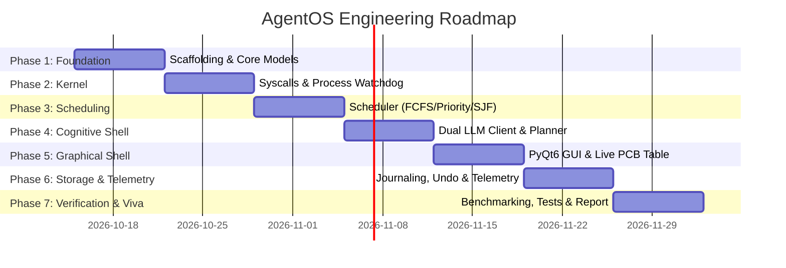

# AgentOS — Engineering Implementation Plan & Academic Roadmap

This document outlines the phased engineering roadmap, architecture specifications, sprint milestones, and academic evaluation criteria for developing **AgentOS: A Cognitive User-Space Micro-Supervisor**.

---

## Table of Contents

- [Project Overview & Milestone Roadmap](#project-overview--milestone-roadmap)
- [Module Breakdown & File Architecture](#module-breakdown--file-architecture)
- [Phase-by-Phase Development Plan](#phase-by-phase-development-plan)
  - [Phase 1: Project Scaffolding & Core Models](#phase-1-project-scaffolding--core-models-week-1)
  - [Phase 2: Micro-Supervisor Kernel & System Calls](#phase-2-micro-supervisor-kernel--system-calls-week-2)
  - [Phase 3: Task Scheduling & Concurrency Engine](#phase-3-task-scheduling--concurrency-engine-week-3)
  - [Phase 4: Cognitive Agent Layer (LLM Shell)](#phase-4-cognitive-agent-layer-llm-shell-week-4)
  - [Phase 5: PyQt6 Desktop Graphical Shell](#phase-5-pyqt6-desktop-graphical-shell-week-5)
  - [Phase 6: Integration, Telemetry & Undo Journal](#phase-6-integration-telemetry--undo-journal-week-6)
  - [Phase 7: Testing, Benchmarking & Viva Defense](#phase-7-testing-benchmarking--viva-defense-week-7)
- [Team Work Breakdown Structure (WBS)](#team-work-breakdown-structure-wbs)
- [Academic Report Structure](#academic-report-structure)
- [Viva Defense & Demonstration Checklist](#viva-defense--demonstration-checklist)

---

## Project Overview & Milestone Roadmap

The implementation is structured into **7 iterative phases** designed to ensure that each component is independently testable before integration.



---

## Module Breakdown & File Architecture

```text
AgentOS/
├── .env.example                  # Environment configuration template
├── .gitignore                    # Version control ignore definitions
├── requirements.txt              # Production and development dependencies
├── README.md                     # Project documentation & OS concept mapping
├── PLAN.md                       # This implementation roadmap
├── main.py                       # Application bootstrap & Qt event loop
│
├── agent/                        # Cognitive Shell (User Mode)
│   ├── __init__.py
│   ├── llm_client.py             # Dual provider: Ollama (local) + Gemini/OpenAI (cloud)
│   ├── planner.py                # Compiles natural language into Syscall Plan
│   └── prompts.py                # System instructions & JSON output constraints
│
├── kernel/                       # Micro-Supervisor Kernel (Supervisor Mode)
│   ├── __init__.py
│   ├── pcb.py                    # TaskPCB data structure & ProcessState enum
│   ├── process_manager.py        # Subprocess spawner, tree-killer & watchdog
│   ├── scheduler.py              # FCFS, Priority, and SJF scheduling queue
│   ├── syscalls.py               # Typed syscall dispatcher & executor
│   ├── sync.py                   # Mutex locks & thread-safe communication
│   ├── file_engine.py            # Sandboxed filesystem operations
│   └── telemetry.py              # psutil CPU/RAM monitoring worker
│
├── security/                     # Security & Privilege Ring
│   ├── __init__.py
│   ├── privilege.py              # Ring 0 vs Ring 3 capability gate
│   └── sandbox.py                # Canonical path validation & jail verification
│
├── storage/                      # Persistence & Recovery
│   ├── __init__.py
│   ├── db.py                     # SQLite task history schema & connection
│   └── journal.py                # Write-ahead transaction log for file undo
│
├── ui/                           # PyQt6 Desktop Interface
│   ├── __init__.py
│   ├── main_window.py            # Central dashboard layout & worker dispatch
│   ├── pcb_table_widget.py       # Live Process Control Block view
│   ├── telemetry_widget.py       # Real-time CPU/RAM gauges
│   ├── terminal_widget.py        # Streaming console & syscall audit log
│   └── elevation_dialog.py       # Ring 0 permission elevation modal
│
└── tests/                        # Automated Verification Suite
    ├── test_pcb.py               # State machine & PCB creation tests
    ├── test_scheduler.py         # Scheduling policy queue ordering tests
    ├── test_sandbox.py           # Path traversal security tests
    └── test_syscalls.py          # Syscall execution & timeout tests
```

---

## Phase-by-Phase Development Plan

### Phase 1: Project Scaffolding & Core Models (Week 1)

**Objective:** Establish the foundational data structures and database models before writing execution code.

1. **Repository Setup:**
   - Initialize Git repository and verify `.gitignore`.
   - Create Python 3.11 virtual environment and install baseline dependencies (`pydantic`, `psutil`, `pytest`, `python-dotenv`).
   - Create `.env.example` and sample `.env`.

2. **Core Data Structures (`kernel/pcb.py`):**
   - Define `ProcessState` enum:
     ```python
     class ProcessState(str, Enum):
         NEW = "NEW"
         READY = "READY"
         RUNNING = "RUNNING"
         WAITING = "WAITING"
         TERMINATED = "TERMINATED"
     ```
   - Implement `TaskPCB` class using `pydantic.BaseModel`:
     - Fields: `pid: int`, `name: str`, `state: ProcessState`, `priority: int`, `created_at: float`, `started_at: Optional[float]`, `ended_at: Optional[float]`, `cpu_time: float`, `peak_memory_mb: float`, `exit_code: Optional[int]`, `error_msg: Optional[str]`.
     - Methods: `transition_to(new_state: ProcessState)`, `record_metrics()`.

3. **System Call Data Models (`kernel/syscalls.py`):**
   - Define `SyscallType` enum (`PROC_SPAWN`, `PROC_KILL`, `FILE_SEARCH`, `FILE_READ`, `FILE_WRITE`, `FILE_MOVE`, `FILE_DELETE`, `SYS_INFO`).
   - Define `SyscallRequest` and `SyscallResult` schemas.

4. **Persistence Layer (`storage/db.py`):**
   - Create SQLite initialization script to store completed tasks, runtime metrics, and audit logs.

---

### Phase 2: Micro-Supervisor Kernel & System Calls (Week 2)

**Objective:** Implement safe, supervised execution primitives for processes and files.

1. **Security & Sandbox Gate (`security/sandbox.py` & `security/privilege.py`):**
   - Implement `validate_safe_path(target_path: Path, allowed_root: Path) -> Path`:
     - Resolves canonical absolute paths using `Path.resolve()`.
     - Rejects any path traversing outside `SANDBOX_ROOT` (`..`, symlinks).
   - Implement `PrivilegeGate`:
     - Classifies operations into **Ring 3** (Safe / Read-only) and **Ring 0** (Privileged / Destructive).

2. **Process Execution & Watchdog (`kernel/process_manager.py`):**
   - Implement `ProcessManager.spawn(cmd: list[str], timeout_sec: int, memory_limit_mb: int) -> SyscallResult`:
     - Uses `subprocess.Popen` with piped `stdout` and `stderr`.
     - Implements a background watchdog thread checking `time.time() - start_time > timeout_sec`.
     - Enforces recursive process tree termination:
       ```python
       parent = psutil.Process(proc.pid)
       for child in parent.children(recursive=True):
           child.kill()
       parent.kill()
       ```
     - Captures peak memory usage during execution using `psutil`.

3. **Filesystem Operations (`kernel/file_engine.py`):**
   - Safe search (`rglob`), read (with byte limit), write, move, and quarantine deletion.
   - Quarantined files are moved to `.agentos_trash/` with a timestamp prefix rather than permanently unlinked.

---

### Phase 3: Task Scheduling & Concurrency Engine (Week 3)

**Objective:** Build the deterministic scheduler and multi-threaded synchronization engine.

1. **Task Queue & Scheduler (`kernel/scheduler.py`):**
   - Implement `TaskScheduler` class supporting three policies:
     - **FCFS (First-Come, First-Served):** Standard FIFO queue.
     - **Priority Scheduling:** Priority queue (`heapq`) ordering tasks by user priority level.
     - **SJF (Shortest Job First):** Sorts tasks by estimated execution time (heuristic based on tool type).
   - Methods: `enqueue(pcb: TaskPCB)`, `next_task() -> Optional[TaskPCB]`, `set_policy(policy: str)`.
   - Compute metrics: **Turnaround Time** ($T_{turnaround} = T_{end} - T_{created}$) and **Waiting Time** ($T_{waiting} = T_{started} - T_{created}$).

2. **Thread Safety & Synchronization (`kernel/sync.py`):**
   - Use `threading.Lock()` to protect the central PCB table and task queue against race conditions.
   - Implement a bounded Producer-Consumer queue between the UI thread and worker threads.

---

### Phase 4: Cognitive Agent Layer (LLM Shell) (Week 4)

**Objective:** Connect local and cloud LLMs to parse natural language into typed System Call DAGs.

1. **Dual LLM Client (`agent/llm_client.py`):**
   - Implement unified interface supporting:
     - **Ollama API** (`http://localhost:11434/api/generate`) with `llama3.2:3b`.
     - **Cloud API** (Gemini or OpenAI API).
   - Automatic fallback: If cloud API fails or key is missing, fall back to local Ollama.

2. **System Prompt & JSON Schema (`agent/prompts.py`):**
   - Instruct the LLM to act strictly as an OS Command Interpreter emitting JSON:
     ```json
     {
       "plan_description": "Compile and run Java program",
       "steps": [
         {"syscall": "FILE_SEARCH", "params": {"pattern": "*.java"}, "ring": 3},
         {"syscall": "PROC_SPAWN", "params": {"cmd": ["javac", "Main.java"]}, "ring": 0},
         {"syscall": "PROC_SPAWN", "params": {"cmd": ["java", "Main"], "timeout": 5}, "ring": 0}
       ]
     }
     ```

3. **Plan Compiler & Validator (`agent/planner.py`):**
   - Validates LLM output against Pydantic schemas.
   - Enforces parameter sanitization before passing calls to the supervisor.

---

### Phase 5: PyQt6 Desktop Graphical Shell (Week 5)

**Objective:** Create the graphical user interface and wire real-time Qt signals.

1. **GUI Layout (`ui/main_window.py`):**
   - Modern dark-themed dashboard.
   - **Top:** Natural language prompt input bar with "Execute" and "Stop" buttons.
   - **Center Left:** Live **Process Control Block (PCB) Table Widget** showing PID, Task Name, State Badge, Priority, CPU Time, and Memory.
   - **Center Right:** **Streaming Console Output Widget** showing real-time stdout/stderr.
   - **Bottom:** **Hardware Telemetry Bar** (CPU per-core meters, RAM usage meter).

2. **Qt Concurrency Architecture:**
   - Run the supervisor and agent on a dedicated `QThread`.
   - Send UI updates via signals:
     - `sig_pcb_updated(TaskPCB)`
     - `sig_console_stream(str)`
     - `sig_telemetry_tick(dict)`
     - `sig_privilege_request(SyscallRequest)`

3. **Privilege Elevation Dialog (`ui/elevation_dialog.py`):**
   - Modal dialog that appears when a **Ring 0** action is queued, displaying the command, target paths, and "Approve" / "Reject" options.

---

### Phase 6: Integration, Telemetry & Undo Journal (Week 6)

**Objective:** Connect all layers, implement undo/rollback, and enable live hardware telemetry.

1. **Transaction Journal & Undo (`storage/journal.py`):**
   - Record every file modification (old path, new path, timestamp) in a SQLite journal.
   - Add an **"Undo Last Action"** button in the GUI to restore quarantined files.

2. **Background Telemetry Daemon (`kernel/telemetry.py`):**
   - Background worker polling `psutil.cpu_percent(percpu=True)` and `psutil.virtual_memory()` every 1000ms.
   - Emits signals to update GUI gauges without lag.

3. **End-to-End Workflow Verification:**
   - Test full execution loop from prompt submission $\rightarrow$ LLM compilation $\rightarrow$ sandbox validation $\rightarrow$ scheduling $\rightarrow$ process watchdog $\rightarrow$ UI stream.

---

### Phase 7: Testing, Benchmarking & Viva Defense (Week 7) — **Completed**

**Objective:** Write automated tests, benchmark scheduling policies, and prepare presentation artifacts.

1. **Automated Test Suite (`tests/`):**
   - `test_pcb.py`: Verify state transitions and metrics calculation.
   - `test_scheduler.py`: Verify that tasks are dispatched in correct order under FCFS, Priority, and SJF.
   - `test_sandbox.py`: Verify that `../` path traversal attempts raise `PermissionError`.
   - `test_syscalls.py`: Verify that infinite-loop processes are terminated at timeout.
   - `test_phase7_verification.py`: Dedicated verification suite covering all 6 Viva Defense demo invariants and scheduling mathematical properties.

2. **Scheduler Benchmarking Script (`benchmark_scheduler.py`):**
   - Execute a batch of 5 synthetic tasks under FCFS vs. Priority vs. SJF.
   - Supports ASCII table, GitHub-flavored Markdown, and JSON export.
   - Quantifies the Convoy Effect ratio and SJF waiting time latency reduction.

3. **Academic Deliverables:**
   - Compiled comprehensive academic project report: [`PROJECT_REPORT.md`](PROJECT_REPORT.md).
   - Prepared 5-minute live demonstration playbook & Viva Q&A bank: [`VIVA_DEMO_GUIDE.md`](VIVA_DEMO_GUIDE.md).
   - Created reproducible demonstration assets: `demo_assets/infinite_loop.py`, `demo_assets/HelloWorld.java`, `demo_assets/sample_worker.py`.

---

## Team Work Breakdown Structure (WBS)

For a team of up to three students, tasks are divided cleanly across architectural boundaries:

| Week | Member 1: Cognitive & LLM Layer | Member 2: Kernel & Scheduling Engine | Member 3: UI, Security & Testing |
|---|---|---|---|
| **Week 1** | Design JSON schemas and prompt templates (`agent/prompts.py`). | Implement `TaskPCB` data model and state machine (`kernel/pcb.py`). | Project scaffolding, `.gitignore`, SQLite schema (`storage/db.py`). |
| **Week 2** | Build dual LLM client for Ollama and Cloud APIs (`agent/llm_client.py`). | Implement `ProcessManager` with watchdog and tree-killer (`kernel/process_manager.py`). | Implement canonical sandbox jail and privilege gates (`security/`). |
| **Week 3** | Implement Plan Compiler and JSON validator (`agent/planner.py`). | Implement `TaskScheduler` (FCFS, Priority, SJF) (`kernel/scheduler.py`). | Implement thread-safe synchronization locks and queue (`kernel/sync.py`). |
| **Week 4** | Build plan recovery and error re-prompting loop. | Implement `FileEngine` with quarantine trash (`kernel/file_engine.py`). | Build PyQt6 Main Window and prompt input widget (`ui/main_window.py`). |
| **Week 5** | Connect LLM output pipeline to Scheduler queue. | Implement `TelemetryDaemon` with `psutil` background worker. | Build `PcbTableWidget` and `ElevationDialog` (`ui/`). |
| **Week 6** | End-to-end multi-step workflow integration. | Implement write-ahead journal and Undo engine (`storage/journal.py`). | Connect Qt signals between worker threads and UI widgets. |
| **Week 7** | Prepare sample demonstration prompts and workflows. | Write scheduling benchmark scripts and metrics analysis. | Write unit tests with `pytest` and assemble final project report. |

---

## Academic Report Structure

Use this outline when writing your final college project report:

1. **Title Page & Certificates**
2. **Abstract** (High-level summary of the cognitive micro-supervisor)
3. **Chapter 1: Introduction**
   - Problem Statement: Vulnerabilities of unconstrained LLM shell execution.
   - Project Objectives: User-space OS abstractions, security rings, process control.
4. **Chapter 2: Literature Survey**
   - Survey of AI Agent frameworks (AutoGPT, LangChain) vs. OS Security Models.
   - Comparison of User-Space Runtimes and Microkernels.
5. **Chapter 3: System Architecture & Design**
   - Three-tier architecture: Cognitive Shell, Micro-Supervisor Kernel, Host OS.
   - Process Control Block (PCB) state transition diagram.
   - Security Boundary & Dual-Mode Privilege Ring.
6. **Chapter 4: Implementation Details**
   - System Call Dispatcher & Validation Engine.
   - Task Scheduler Algorithms (FCFS, Priority, SJF).
   - Watchdog Timer and Recursive Process Tree Termination.
   - PyQt6 Concurrency & Non-blocking Signal Pipeline.
7. **Chapter 5: Results, Benchmarks & Evaluation**
   - Scheduler Performance Comparison: FCFS vs. SJF (Turnaround & Waiting Times).
   - Watchdog Timeout Verification (Handling infinite loops).
   - Security Jail Penetration Testing (Preventing path traversals).
8. **Chapter 6: Conclusion & Future Scope**
   - Summary of achievements.
   - Future enhancements: Voice interface, multi-user access control.
9. **References**

---

## Viva Defense & Demonstration Checklist

Before your final evaluation, ensure the following test cases are ready to demonstrate live:

- [x] **Demo 1: Live Compilation with PCB Tracking**
  - Prompt: *"Compile and run `Main.java` with a 5-second timeout."*
  - Show the examiner the live PCB entry transitioning from `NEW` $\rightarrow$ `RUNNING` $\rightarrow$ `TERMINATED`.
  - Automated verification: `tests/test_phase7_verification.py::test_viva_demo1_execution_lifecycle_with_pcb_tracking`.
- [x] **Demo 2: Process Watchdog Catching an Infinite Loop**
  - Spawn a script containing `while True: pass` (`demo_assets/infinite_loop.py`).
  - Show the watchdog terminating the process tree after the timeout expires, reporting `TIMEOUT_EXPIRED`.
  - Automated verification: `tests/test_phase7_verification.py::test_viva_demo2_watchdog_infinite_loop_timeout`.
- [x] **Demo 3: Ring 0 Privilege Elevation Prompt**
  - Prompt: *"Delete the temporary files in the test directory."*
  - Show the modal dialog intercepting the action and requesting user confirmation before proceeding.
  - Automated verification: `tests/test_phase7_verification.py::test_viva_demo3_ring0_elevation_gate_security`.
- [x] **Demo 4: File Undo Recovery**
  - Delete a test file, then click **"Undo Last Action"** to immediately restore the file from `.agentos_trash`.
  - Automated verification: `tests/test_phase7_verification.py::test_viva_demo4_file_quarantine_and_undo_recovery`.
- [x] **Demo 5: Scheduling Policy Comparison**
  - Submit multiple tasks and switch policies between FCFS and SJF, showing the difference in completion order and calculated turnaround metrics.
  - Automated verification: `tests/test_phase7_verification.py::test_viva_demo5_dynamic_scheduler_policy_switch` & `benchmark_scheduler.py`.
- [x] **Demo 6: Offline Operation via Ollama**
  - Disconnect Wi-Fi and execute a task using local `llama3.2:3b` to prove offline reliability.
  - Automated verification: `tests/test_phase7_verification.py::test_viva_demo6_offline_resilience`.
