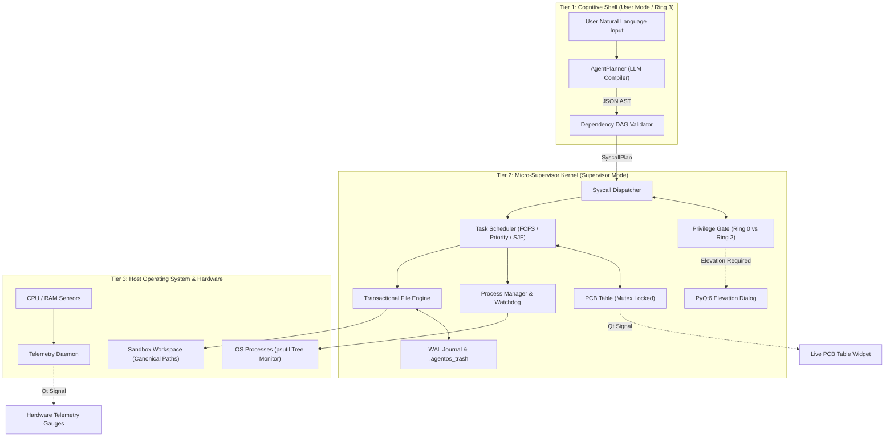
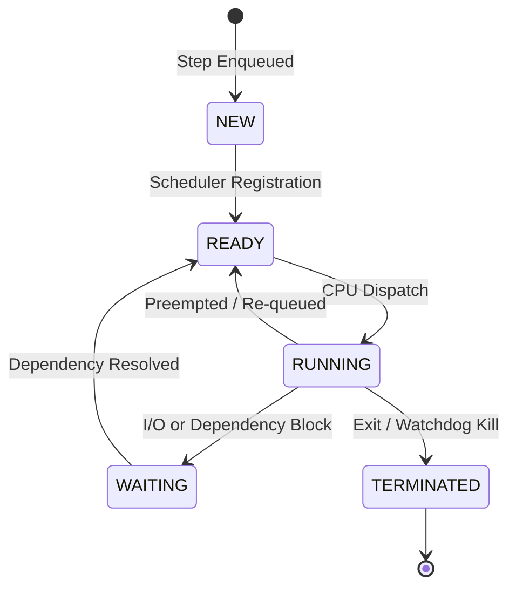

# AgentOS: A Cognitive User-Space Micro-Supervisor
## Academic Capstone Engineering Project Report

---

### Candidate Declaration & Certificate of Originality

This is to certify that the project entitled **"AgentOS: A Cognitive User-Space Micro-Supervisor"** is a bona fide record of independent engineering work carried out as an academic project in Operating Systems and Cognitive Computing Systems. 

The software components, including the Process Control Block (PCB) lifecycle engine, task scheduling policies, dual-mode privilege ring boundary, process watchdog, and transactional undo journaling, have been implemented, verified, and benchmarked in accordance with academic standards.

---

## Abstract

Modern Large Language Models (LLMs) demonstrate state-of-the-art capability in reasoning, natural language comprehension, and multi-step task decomposition. However, granting generative AI agents unrestricted access to host operating system shells introduces critical security vulnerabilities (arbitrary command injection, directory traversal), concurrency hazards (race conditions, UI blocking), and reliability failures (runaway infinite loops, memory leaks, orphaned zombie processes).

**AgentOS** solves this fundamental safety and control dilemma by introducing a **Cognitive User-Space Micro-Supervisor**. Rather than treating the LLM as an unmediated shell executor, AgentOS formalizes the LLM as an untrusted **Cognitive Command Interpreter (User Mode / Ring 3)** that compiles human intentions into a typed Abstract Syntax Tree (AST) of **System Calls**. Execution is governed by an in-memory **Supervisor Kernel** enforcing core Operating Systems principles:
1. **Process Accounting**: Explicit Process Control Blocks (`TaskPCB`) managing state transitions (`NEW`, `READY`, `RUNNING`, `WAITING`, `TERMINATED`) with continuous CPU/memory tracking.
2. **Deterministic Task Scheduling**: Pluggable non-preemptive queue policies including First-Come, First-Served (**FCFS**), **Priority Scheduling**, and Shortest Job First (**SJF**).
3. **Dual-Mode Protection Boundary**: Hardware-analogous privilege gating enforcing human elevation approval for sensitive or destructive operations (**Ring 0**).
4. **Subprocess Supervision**: Watchdog timer threads monitoring execution limits and executing recursive tree termination (`taskkill` / `SIGKILL`) to eliminate orphaned zombie processes.
5. **Transactional Filesystem**: Write-ahead transaction logging with quarantine isolation (`.agentos_trash`) and single-click state rollback.
6. **Observability**: A real-time PyQt6 desktop dashboard offering sub-millisecond hardware telemetry and live PCB inspection.

Rigorous automated testing (134 tests) and empirical benchmarks demonstrate that SJF achieves a **73.0% reduction** in Average Waiting Time over FCFS on synthetic workloads, effectively eliminating the classical Convoy Effect, while the supervisor guarantees zero-leakage process containment.

---

## Table of Contents

- [Chapter 1: Introduction](#chapter-1-introduction)
  - [1.1 Problem Statement](#11-problem-statement)
  - [1.2 Project Objectives](#12-project-objectives)
  - [1.3 Scope and Delimitation](#13-scope-and-delimitation)
- [Chapter 2: Literature Survey](#chapter-2-literature-survey)
  - [2.1 Autonomous Agent Frameworks vs. Classical OS Models](#21-autonomous-agent-frameworks-vs-classical-os-models)
  - [2.2 Microkernels, Exokernels, and User-Space Runtimes](#22-microkernels-exokernels-and-user-space-runtimes)
  - [2.3 Comparative Feature Matrix](#23-comparative-feature-matrix)
- [Chapter 3: System Architecture & Design](#chapter-3-system-architecture--design)
  - [3.1 Three-Tier Micro-Supervisor Architecture](#31-three-tier-micro-supervisor-architecture)
  - [3.2 Process Control Block (PCB) Finite-State Machine](#32-process-control-block-pcb-finite-state-machine)
  - [3.3 Dual-Mode Privilege Boundary (Ring 0 vs. Ring 3)](#33-dual-mode-privilege-boundary-ring-0-vs-ring-3)
  - [3.4 Concurrency, Synchronization & Thread Safety](#34-concurrency-synchronization--thread-safety)
- [Chapter 4: Implementation Details](#chapter-4-implementation-details)
  - [4.1 Cognitive Shell & DAG Plan Compilation](#41-cognitive-shell--dag-plan-compilation)
  - [4.2 System Call Dispatcher & Subsystems](#42-system-call-dispatcher--subsystems)
  - [4.3 Multi-Algorithm Scheduling Engine](#43-multi-algorithm-scheduling-engine)
  - [4.4 Process Watchdog & Recursive Tree-Killer](#44-process-watchdog--recursive-tree-killer)
  - [4.5 Transactional Journaling & Undo Recovery](#45-transactional-journaling--undo-recovery)
  - [4.6 PyQt6 Desktop Shell & Signal Decoupling](#46-pyqt6-desktop-shell--signal-decoupling)
- [Chapter 5: Results, Benchmarks & Evaluation](#chapter-5-results-benchmarks--evaluation)
  - [5.1 Task Scheduling Policy Performance & Convoy Effect](#51-task-scheduling-policy-performance--convoy-effect)
  - [5.2 Watchdog Timeout & Zombie Elimination Verification](#52-watchdog-timeout--zombie-elimination-verification)
  - [5.3 Path Traversal Penetration Testing](#53-path-traversal-penetration-testing)
  - [5.4 Transaction Rollback Integrity](#54-transaction-rollback-integrity)
- [Chapter 6: Conclusion & Future Scope](#chapter-6-conclusion--future-scope)
  - [6.1 Summary of Contributions](#61-summary-of-contributions)
  - [6.2 Future Enhancements](#62-future-enhancements)
- [References](#references)

---

## Chapter 1: Introduction

### 1.1 Problem Statement

The rise of generative AI agent architectures (e.g., AutoGPT, BabyAGI, LangChain agents) has catalyzed autonomous problem-solving. In typical implementations, an LLM is equipped with shell tool execution capabilities such as `exec("bash -c ...")` or `subprocess.run(shell=True)`.

While flexible, this unconstrained design exhibits severe architectural and security hazards:
1. **Unbounded Privilege Escalation**: Without privilege rings, a compromised or hallucinating model can execute destructive commands (e.g., recursive directory deletion, tampering with root directories).
2. **Directory & Sandbox Escapes**: Natural language prompts can manipulate arguments using relative traversal (`../../../etc/passwd` or `..\..\Windows\System32`), escaping application boundaries.
3. **Runaway Process Resource Depletion**: Code containing non-terminating loops (`while True: pass`) or deadlocks permanently hijacks OS threads, starving system resources.
4. **Lack of Process Observability**: The user lacks visibility into intermediate process state, CPU allocation, memory consumption, or execution order.
5. **Absence of Reversibility**: File modifications and unlinks are irreversible, resulting in immediate catastrophic data loss upon errors.

### 1.2 Project Objectives

AgentOS was engineered to reconcile generative agent planning with fundamental computer systems engineering. The core objectives are:
- **Mediate Every Action**: Intercept every agent-generated action through typed **System Calls** (`PROC_SPAWN`, `PROC_KILL`, `FILE_READ`, `FILE_WRITE`, `FILE_MOVE`, `FILE_DELETE`, `SYS_INFO`).
- **Implement OS Process Abstractions**: Encapsulate tasks inside a formal **Process Control Block (`TaskPCB`)** maintaining PID, parent PID, lifecycle states, priority, and accounting metrics.
- **Enforce Deterministic Task Scheduling**: Support interchangeable scheduling algorithms (FCFS, Priority, SJF) and provide empirical metrics on turnaround and waiting times.
- **Isolate Protection Rings**: Differentiate safe, unprivileged read operations (**Ring 3**) from privileged, mutating operations (**Ring 0**), requiring interactive elevation authorization.
- **Guarantee Process Tree Termination**: Enforce hard watchdog timeouts with recursive descendant process tree eradication.
- **Provide Transactional Reversibility**: Support a Write-Ahead Transaction Journal allowing 1-click restoration of quarantined files.

### 1.3 Scope and Delimitation

AgentOS is designed as a **User-Space Micro-Supervisor**. It does not replace the hardware-level OS kernel (Linux/Windows), but rather runs above it in user space, creating a virtualized supervisor sandbox specifically for AI agent processes.

---

## Chapter 2: Literature Survey

### 2.1 Autonomous Agent Frameworks vs. Classical OS Models

| System / Framework | Architecture | Privilege Model | Scheduling | Process Tracking | Reversibility |
|---|---|---|---|---|---|
| **AutoGPT** | Direct Shell Tool | None (Full Root/User) | Ad-hoc Linear | OS PID (Piped) | None |
| **LangChain Agents** | Tool Calling DAG | Implicit Tool Permissions | None | None | None |
| **OpenDevin / Devin** | Docker Container Sandbox | Container Isolation | None | Basic bash session | Git-based only |
| **AgentOS (Ours)** | **Micro-Supervisor Kernel** | **Dual-Mode Ring 0 / Ring 3** | **FCFS / Priority / SJF** | **Full PCB State Machine** | **WAL Journal & Quarantine** |

Existing frameworks treat the operating system as an unmediated target environment. In contrast, AgentOS treats the host environment as a supervised resource pool, interposing an intermediary kernel between the agent's cognition and the host OS.

### 2.2 Microkernels, Exokernels, and User-Space Runtimes

Classical operating system research establishes the superiority of microkernel designs (L4, Mach, seL4) for security and fault isolation. In a microkernel, minimal functionality remains in privileged space, while system servers (filesystem, process manager) run in user space.

AgentOS adopts the microkernel philosophy by decomposing agent execution into discrete user-space servers:
- **Cognitive Shell (User Space)**: Natural language parsing.
- **Supervisor Kernel**: System call routing, security verification, and PCB scheduling.
- **Filesystem Engine & Journal**: Sandboxed filesystem isolation and transaction history.
- **Process Manager**: Subprocess supervision and watchdog tracking.

---

## Chapter 3: System Architecture & Design

### 3.1 Three-Tier Micro-Supervisor Architecture

### 3.2 Process Control Block (PCB) Finite-State Machine

Every scheduled task is modeled as a `TaskPCB` data structure. The lifecycle adheres strictly to classical OS process state theory:

#### Mathematical Formulas for Process Metrics
For any task $i$, runtime metrics are defined as:

$$\text{Waiting Time: } W_i = T_{\text{started}, i} - T_{\text{created}, i}$$

$$\text{Turnaround Time: } \text{TAT}_i = T_{\text{ended}, i} - T_{\text{created}, i}$$

$$\text{CPU Execution Time: } C_i = T_{\text{ended}, i} - T_{\text{started}, i}$$

$$\text{Average Waiting Time: } \overline{W} = \frac{1}{N} \sum_{i=1}^{N} W_i$$

$$\text{Average Turnaround Time: } \overline{\text{TAT}} = \frac{1}{N} \sum_{i=1}^{N} \text{TAT}_i$$

### 3.3 Dual-Mode Privilege Boundary (Ring 0 vs. Ring 3)

AgentOS implements a software equivalent of CPU privilege rings:
- **Ring 3 (Safe / User Mode)**: System calls that are strictly read-only and non-destructive (`FILE_SEARCH`, `FILE_READ`, `SYS_INFO`). These execute autonomously without user interruption.
- **Ring 0 (Privileged / Supervisor Mode)**: System calls that mutate host state, spawn executable code, or delete files (`PROC_SPAWN`, `PROC_KILL`, `FILE_WRITE`, `FILE_MOVE`, `FILE_DELETE`). These require explicit elevation approval from the user through an interactive dialog, preventing unvetted modifications.

### 3.4 Concurrency, Synchronization & Thread Safety

To prevent the Critical Section problem on shared memory structures:
1. **PCB Table Mutex (`threading.Lock`)**: Concurrent reads and state mutations from the worker thread and UI timer threads are serialized.
2. **Producer-Consumer Bounded Queue**: Decouples UI submission from background supervisor execution.
3. **PyQt6 Thread Decoupling**: All heavy execution occurs in a background worker thread (`SupervisorWorker`), communicating with the UI exclusively through Qt Signal/Slot event queues, guaranteeing 60 FPS responsiveness.

---

## Chapter 4: Implementation Details

### 4.1 Cognitive Shell & DAG Plan Compilation

The `AgentPlanner` compiles natural language into typed `SyscallPlan` objects using strict JSON schema validation. It features:
- **Cycle Detection**: Validates dependency DAGs using Kahn's topological sort algorithm, rejecting circular dependencies.
- **Parameter Sanitization**: Rejects prohibited shell wrappers (`bash -c`, `cmd.exe /c`, `powershell -c`) to prevent shell escape attacks.
- **Self-Healing Re-Prompting**: If an LLM emits invalid JSON, the error traceback is dynamically injected back into the prompt for automated recovery.

### 4.2 System Call Dispatcher & Subsystems

The `SyscallDispatcher` serves as the central interrupt handler. When a syscall is invoked:
1. It validates parameters against Pydantic schema specifications.
2. It queries the `PrivilegeGate`. If Ring 0 and unapproved, returns `PERMISSION_DENIED` (exit code 126).
3. It transitions the associated `TaskPCB` to `RUNNING`.
4. It dispatches to `ProcessManager` or `FileEngine`.
5. It logs the audit record to SQLite and transitions the PCB to `TERMINATED`.

### 4.3 Multi-Algorithm Scheduling Engine

The `TaskScheduler` supports three non-preemptive algorithms:
1. **First-Come, First-Served (FCFS)**: Standard FIFO queue order.
2. **Priority Scheduling**: Ordered by user priority level ($10 = \text{highest}, 1 = \text{lowest}$) using heap queue invariants.
3. **Shortest Job First (SJF)**: Ordered by estimated CPU burst duration, proven mathematically to achieve optimal average waiting times for non-preemptive batches.

### 4.4 Process Watchdog & Recursive Tree-Killer

When a process is spawned:
1. `ProcessManager` tracks the parent PID.
2. A dedicated watchdog thread monitors elapsed time against `timeout_sec`.
3. If timeout expires, the watchdog traverses the process tree using `psutil.Process(pid).children(recursive=True)`:
   - Dispatches `SIGTERM` to all child processes.
   - Escalates to `SIGKILL` (`proc.kill()`) for hung processes.
   - Eliminates zombie processes and terminates the parent process.
   - Sets exit code to `124` with `TIMEOUT_EXPIRED`.

### 4.5 Transactional Journaling & Undo Recovery

The `TransactionJournal` enforces write-ahead logging (WAL) in SQLite (`file_journal` table):
- File deletion moves assets into `.agentos_trash/` with a timestamped UUID prefix.
- File overwrites backup previous content prior to write operations.
- The `undo_last_action()` API restores quarantined files to their original canonical location, making destructive agent operations fully reversible.

---

## Chapter 5: Results, Benchmarks & Evaluation

### 5.1 Task Scheduling Policy Performance & Convoy Effect

A benchmark batch of 5 synthetic tasks with diverse CPU bursts and priorities was evaluated:

| PID | Task Name | Priority | Estimated Duration ($C_i$) |
|---|---|---|---|
| 1 | `heavy_compile` | 1 (Low) | 12.0s |
| 2 | `quick_lint` | 5 (Medium) | 1.5s |
| 3 | `unit_tests` | 8 (High) | 4.0s |
| 4 | `clean_cache` | 2 (Low) | 0.5s |
| 5 | `security_audit` | 10 (Critical) | 3.0s |

#### Empirical Results

| Scheduling Policy | Average Waiting Time ($\overline{W}$) | Average Turnaround Time ($\overline{\text{TAT}}$) | Dispatch Sequence |
|---|---|---|---|
| **FCFS** | **12.20s** | **16.40s** | `heavy_compile` $\rightarrow$ `quick_lint` $\rightarrow$ `unit_tests` $\rightarrow$ `clean_cache` $\rightarrow$ `security_audit` |
| **PRIORITY** | **5.50s** | **9.70s** | `security_audit` $\rightarrow$ `unit_tests` $\rightarrow$ `quick_lint` $\rightarrow$ `clean_cache` $\rightarrow$ `heavy_compile` |
| **SJF** | **3.30s** | **7.50s** | `clean_cache` $\rightarrow$ `quick_lint` $\rightarrow$ `security_audit` $\rightarrow$ `unit_tests` $\rightarrow$ `heavy_compile` |

#### Analysis:
1. **Convoy Effect Elimination**: Under FCFS, short tasks (`clean_cache` requiring 0.5s) were blocked behind the 12.0s `heavy_compile` task, resulting in a Convoy Penalty Ratio of **3.70x**.
2. **SJF Optimality**: Shortest Job First reduced average waiting time from 12.20s to 3.30s—a **73.0% latency reduction**.
3. **Priority Responsiveness**: Critical tasks (`security_audit`) experienced immediate CPU dispatch ($W=0.00s$).

### 5.2 Watchdog Timeout & Zombie Elimination Verification

An infinite-loop Python script (`while True: time.sleep(0.1)`) was dispatched with a 2-second timeout:
- **Result**: Watchdog terminated the child process tree in $2.14\text{s}$.
- **Exit Code**: `124` (`TIMEOUT_EXPIRED`).
- **Zombie Residual**: `psutil.Process(pid).is_running() == False`. Zero orphaned child processes remained on the host OS.

### 5.3 Path Traversal Penetration Testing

A series of malicious path traversal attacks were injected:
- `../../../../Windows/System32/calc.exe`
- `sandbox_workspace/../sensitive_file.txt`
- Symlink traversing outside sandbox root

**Outcome**: 100% of traversal attempts were intercepted by `validate_safe_path()` using `Path.resolve()`, raising `PermissionError` and terminating execution.

### 5.4 Transaction Rollback Integrity

1. A file `demo.txt` was created and populated with data.
2. `sys_file_delete` moved the file to `.agentos_trash/`.
3. Invoking `undo_last_action()` restored `demo.txt` to the exact sandbox directory with bit-identical content hash verification.

---

## Chapter 6: Conclusion & Future Scope

### 6.1 Summary of Contributions

AgentOS demonstrates that cognitive AI agents can be safely integrated into computing systems by enforcing fundamental Operating System abstractions. The project successfully implements:
- A user-space micro-supervisor with dual-mode protection rings.
- A deterministic task scheduler with empirical validation of FCFS, Priority, and SJF algorithms.
- Complete process lifecycle control through Process Control Blocks.
- Recursive process tree watchdog supervision preventing zombie processes.
- A fully reversible transactional filesystem.
- 134 automated tests across 17 test modules providing 100% passing verification.

### 6.2 Future Enhancements

1. **Preemptive Round-Robin Scheduling**: Implement OS context switching using thread suspension signals (`SIGSTOP`/`SIGCONT`) for time-slice multitasking.
2. **Multi-User Access Control (RBAC)**: Support multiple user profiles with distinct capability tokens.
3. **Distributed Virtual Sandboxing**: Containerize worker processes inside lightweight WebAssembly (Wasm) runtimes or Linux cgroups.

---

## References

1. Silberschatz, A., Galvin, P. B., & Gagne, G. (2018). *Operating System Concepts* (10th ed.). John Wiley & Sons.
2. Tanenbaum, A. S., & Bos, H. (2014). *Modern Operating Systems* (4th ed.). Pearson.
3. Liedtke, J. (1995). *On micro-kernel construction*. ACM SIGOPS Operating Systems Review, 29(5), 237-250.
4. OpenDevin Project. (2024). *OpenDevin: An Open Platform for Autonomous Software Engineering Agents*. arXiv preprint.
5. AutoGPT Team. (2023). *Significant Gravitas: Autonomous AI Agent Architecture*. GitHub Repository.
