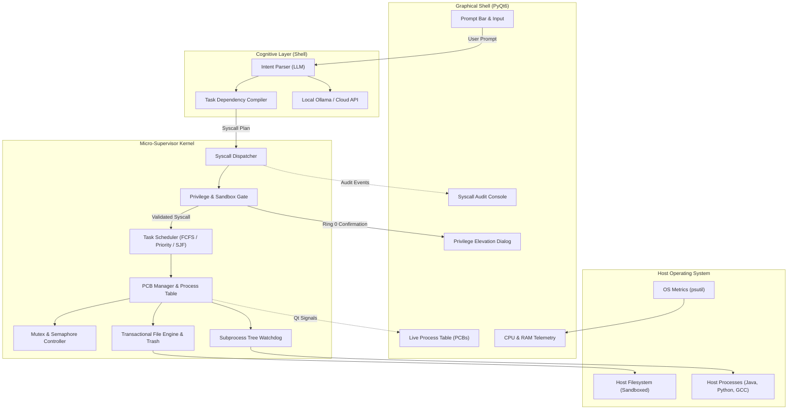

# AgentOS — Cognitive User-Space Micro-Supervisor

[](https://www.python.org/)
[](https://www.riverbankcomputing.com/software/pyqt/)
[](#system-architecture)
[](LICENSE)
[](#operating-systems-concepts-mapping)

> **AgentOS** is an intelligent, user-space micro-supervisor and desktop execution environment. It bridges generative AI agentic planning with fundamental operating system engineering principles—turning natural-language instructions into structured, verified, and scheduled operating system tasks.

Unlike naive AI wrappers that blindly invoke shell commands, AgentOS operates as a **controlled operating environment**: all agent intentions are compiled into an Abstract Syntax Tree of mediated **System Calls**, managed through **Process Control Blocks (PCBs)**, sequenced via a **Deterministic Task Scheduler**, protected by a **Dual-Mode Privilege Ring**, and observed through a **real-time PyQt6 Graphical Shell**.

---

## Table of Contents

- [Motivation & Core Philosophy](#motivation--core-philosophy)
- [Operating Systems Concepts Mapping](#operating-systems-concepts-mapping)
- [System Architecture](#system-architecture)
- [Core Features](#core-features)
- [Safety & Protection Boundary](#safety--protection-boundary)
- [Technology Stack](#technology-stack)
- [Project Directory Structure](#project-directory-structure)
- [Installation & Setup](#installation--setup)
- [Configuration](#configuration)
- [Usage & Example Scenarios](#usage--example-scenarios)
- [Academic Demonstration & Viva Defense Guide](#academic-demonstration--viva-defense-guide)
- [Team Contributions](#team-contributions)
- [License](#license)

---

## Motivation & Core Philosophy

Modern operating systems provide low-level primitives (processes, threads, files, memory), while large language models excel at reasoning and intent decomposition. However, directly connecting an LLM to a host shell creates severe hazards:
1. **Security Vulnerabilities:** Risk of path traversal, unintended file deletion, and prompt injection attacks.
2. **Process Runaway:** Hanging background processes, memory leaks, and unresponsive shells.
3. **Loss of Concurrency & Observability:** Lack of execution tracking, state visualization, or transaction rollback.

**AgentOS solves this by implementing an OS abstraction layer in user space.** The LLM acts purely as a **Cognitive Shell / Command Interpreter**, while an internal **Micro-Supervisor Kernel** enforces process lifecycle tracking, CPU/task scheduling policies, resource quotas, and access control.

```
+-----------------------------------------------------------------------------------+
|  TRADITIONAL OS:   User --> Shell (bash/sh) --> System Calls --> Kernel --> HW   |
|  AGENTOS MODEL:    User --> LLM Shell ------> Agent Syscalls --> Supervisor --> OS |
+-----------------------------------------------------------------------------------+
```

---

## Operating Systems Concepts Mapping

AgentOS translates standard Operating Systems textbook topics (*Silberschatz, Galvin & Gagne*) into concrete, demonstrable software components:

| OS Concept | Theoretical Foundation | AgentOS Implementation | Demonstrable Feature in GUI |
|---|---|---|---|
| **Command Interpreter (Shell)** | User-to-OS interface translating human commands into kernel instructions. | **Cognitive Agent Layer** (`agent/planner.py`) decomposes natural language into structured System Call DAGs. | Interactive prompt bar with live plan preview before execution. |
| **Dual-Mode Protection & Rings** | Hardware/software privilege rings (Ring 0 Kernel vs. Ring 3 User Mode). | **Privilege Gate** (`security/privilege.py`): Ring 3 (Safe/Read-only) vs. Ring 0 (Privileged/Destructive). | Ring 0 operations trigger an interactive UI elevation dialog requiring explicit human consent. |
| **Process Control Block (PCB)** | Kernel data structure tracking PID, state, execution time, and resource limits. | **TaskPCB Class** (`kernel/pcb.py`): Tracks PID, state machine (`NEW`, `READY`, `RUNNING`, `WAITING`, `TERMINATED`), CPU time, peak memory. | Real-time **Process Table Widget** with live state badges and resource usage. |
| **Process Scheduling** | CPU scheduling policies allocating runtime to queued tasks. | **Task Scheduler** (`kernel/scheduler.py`): Configurable policies including **FCFS**, **Priority Scheduling**, and **Shortest Job First (SJF)**. | Scheduler policy switcher in UI with comparative Turnaround & Waiting Time metrics. |
| **Process Synchronization** | Preventing race conditions on shared data structures; solving the Critical Section problem. | **Concurrency & Sync Engine** (`kernel/sync.py`): Mutex locks protecting the central PCB table; Producer-Consumer bounded queue for UI dispatch. | Thread-safe background execution without freezing the PyQt6 GUI thread. |
| **Process Supervision & Watchdogs** | Handling signals, timeouts, process trees, and orphaned child processes. | **Process Watchdog** (`kernel/process_manager.py`): Monitors child processes using `psutil`, enforces CPU time limits, and kills process trees recursively. | Automatic timeout termination with zombie prevention for hung programs. |
| **File System Integrity & Sandboxing** | Directory structure, canonical paths, access control lists, and recovery. | **Virtual File Engine** (`kernel/file_engine.py`): Enforces canonical path jail (`Path.resolve()`), write-ahead transaction log, and `.agentos_trash` quarantine. | 1-Click **"Undo Action"** restoring modified or quarantined files from transaction logs. |
| **Resource Accounting & Telemetry** | Observing CPU utilization, virtual memory/swap, and I/O rates. | **Telemetry Daemon** (`kernel/telemetry.py`): Periodic background polling of CPU per core, RAM, and host metrics. | Real-time CPU/RAM meters and hardware telemetry graphs. |

---

## System Architecture

AgentOS uses a decoupled, three-tier architecture separating presentation, cognitive planning, and deterministic execution.



### The Request-to-Execution Lifecycle

1. **Submission:** The user enters a request (e.g., *"Find all Java files in my assignment folder, compile them, and run the main class with a 5s timeout"*).
2. **Cognitive Decomposition:** The Agent Layer converts the instruction into an ordered list of typed **System Calls** (`sys_file_search`, `sys_proc_spawn`, `sys_file_read`).
3. **Privilege & Sandbox Check:** Each call is checked by the Security Gate:
   - Validates that paths reside within allowed sandbox roots.
   - If an operation is marked as **Ring 0** (destructive or arbitrary binary execution), execution halts and presents a confirmation prompt to the user.
4. **PCB Creation & Scheduling:** The task is wrapped in a `TaskPCB`, assigned a unique PID and priority, and pushed into the ready queue.
5. **Supervised Execution:** The worker thread executes the task, streaming stdout/stderr in real time and tracking peak memory and CPU execution time.
6. **Watchdog Verification:** If a process runs longer than its configured timeout, the watchdog issues a `SIGTERM` followed by a recursive tree termination (`taskkill` / `SIGKILL`).
7. **Telemetry & Audit:** The outcome, exit code, and runtime metrics are updated in the PCB table and permanently logged to the SQLite audit database.

---

## Core Features

- **Natural Language Task Compilation:** Decomposes multi-step user prompts into deterministic, validated execution graphs.
- **Dual-Mode Privilege Architecture:** Protects the host system by distinguishing between safe read operations and sensitive system operations.
- **Real-Time Process Control Block (PCB) Inspector:** Live visual representation of task states (`NEW`, `READY`, `RUNNING`, `WAITING`, `TERMINATED`).
- **Multi-Algorithm Task Scheduler:** Switch dynamically between **First-Come-First-Served (FCFS)**, **Priority Scheduling**, and **Shortest Job First (SJF)**.
- **Transactional Filesystem with Undo:** Safe file movements and deletions backed by a write-ahead journal and quarantine directory.
- **Approved Windows App Launching:** Open Calculator, Notepad, Task Manager, or Edge through a dedicated Ring 0 syscall and explicit user confirmation.
- **Dual-LLM Engine:** Full support for **100% offline, private local models via Ollama** (`llama3.2`, `mistral`, `qwen2.5`) or cloud APIs (Google Gemini, OpenAI).
- **Subprocess Tree Isolation & Timeout Guard:** Prevents runaway infinite loops or zombie processes from degrading host performance.
- **Real-Time Hardware Telemetry:** Dynamic CPU per-core utilization and memory meters via non-blocking background polling.

---

## Safety & Protection Boundary

AgentOS implements defence-in-depth principles:

1. **Canonical Path Jail:** Every path argument is resolved using `Path(target).resolve()`. If the resolved path does not start with an authorized sandbox root, the call is rejected with `ERR_PERMISSION_DENIED`.
2. **Quarantine Over Deletion:** The `sys_file_delete` call moves files to `.agentos_trash/<timestamp>_<filename>` with recovery metadata, avoiding irreversible data loss.
3. **Command Whitelisting:** Execution is restricted to pre-approved compilers and interpreters (`python`, `javac`, `java`, `gcc`) with explicit argument sanitization. Arbitrary shell command strings (`cmd.exe /c`, `sh -c`) are prohibited. Desktop application launching is limited to Calculator, Notepad, Task Manager, and Edge through a separate fixed-target syscall.
4. **Execution Timeouts:** All child processes enforce a strict default timeout (e.g., 10 seconds), preventing infinite loops.
5. **Secret Redaction:** API keys and environment variables are strictly loaded via `.env` and never written to logs or SQLite audit tables.

---

## Technology Stack

| Layer | Component | Technology | Rationale |
|---|---|---|---|
| **Presentation** | Graphical Interface | **PyQt6** | Native desktop widgets, hardware-accelerated rendering, robust multithreading via `QThread`. |
| **Supervisor** | Process & Resource Telemetry | **psutil** | Cross-platform process tree inspection, CPU/RAM polling, and signal handling. |
| **Agent / LLM** | Local Reasoning (Offline) | **Ollama** (`llama3.2:3b` / `mistral:7b`) | Privacy, zero API cost, reliable performance during offline college presentations. |
| **Agent / LLM** | Cloud Reasoning (Online) | **Google Gemini / OpenAI API** | Complex multi-step reasoning when an internet connection is available. |
| **Validation** | Data Models & Schemas | **Pydantic v2** | Strict validation of System Call schemas and PCB state definitions. |
| **Storage** | Audit Logging & Transactions | **SQLite 3** | Lightweight, zero-configuration relational storage for execution history and journal logs. |
| **Testing** | Test Automation | **pytest** | Unit and integration testing for scheduler, syscalls, and sandbox jails. |

---

## Project Directory Structure

```text
AgentOS/
├── .env.example              # Environment variables template
├── .gitignore                # Git ignore rules for Python, virtualenv, and data
├── requirements.txt          # Python dependencies
├── README.md                 # Complete project documentation
├── PLAN.md                   # Phased engineering roadmap and sprint plan
├── main.py                   # Application entry point & Qt event loop
│
├── agent/                    # Cognitive Layer (LLM Shell)
│   ├── __init__.py
│   ├── llm_client.py         # Dual provider client (Ollama & Cloud API)
│   ├── planner.py            # Natural language to Syscall DAG compiler
│   └── prompts.py            # System prompts and JSON response schemas
│
├── kernel/                   # Micro-Supervisor Kernel
│   ├── __init__.py
│   ├── pcb.py                # Process Control Block & ProcessState definitions
│   ├── process_manager.py    # Child process spawning, tree kill & watchdog
│   ├── scheduler.py          # FCFS, Priority, and SJF scheduling algorithms
│   ├── syscalls.py           # Typed system call definitions & dispatcher
│   ├── sync.py               # Mutex locks, thread pools & bounded queues
│   ├── file_engine.py        # Sandboxed file manager with transaction journal
│   └── telemetry.py          # Background psutil CPU/RAM monitoring daemon
│
├── security/                 # Protection Rings & Validation
│   ├── __init__.py
│   ├── privilege.py          # Ring 0 vs Ring 3 capability gate
│   └── sandbox.py            # Canonical path resolution & jail validation
│
├── storage/                  # Persistence & Recovery
│   ├── __init__.py
│   ├── db.py                 # SQLite database initialization
│   └── journal.py            # Transaction log for undo/recovery
│
├── ui/                       # PyQt6 Desktop Interface
│   ├── __init__.py
│   ├── main_window.py        # Central dashboard window
│   ├── pcb_table_widget.py   # Live Process Control Block table
│   ├── telemetry_widget.py   # CPU & RAM live gauges
│   ├── terminal_widget.py    # Streaming console output & syscall log
│   └── elevation_dialog.py   # Ring 0 confirmation modal
│
└── tests/                    # Test Suite
    ├── test_pcb.py           # State transition unit tests
    ├── test_scheduler.py     # Scheduling policy unit tests
    ├── test_sandbox.py       # Path traversal security tests
    └── test_syscalls.py      # System call execution tests
```

---

## Installation & Setup

### Prerequisites

- **Python 3.11+** installed and added to your system `PATH`.
- **Git** version control.
- *(Optional for Offline Mode)* **[Ollama](https://ollama.ai/)** installed with a downloaded model:
  ```bash
  ollama pull llama3.2:3b
  ```

### 1. Clone the Repository

```bash
git clone https://github.com/your-username/AgentOS.git
cd AgentOS
```

### 2. Create and Activate Virtual Environment

**Windows PowerShell:**
```powershell
python -m venv .venv
.venv\Scripts\Activate.ps1
```

**Windows Command Prompt:**
```bat
python -m venv .venv
.venv\Scripts\activate.bat
```

**Linux / macOS:**
```bash
python3 -m venv .venv
source .venv/bin/activate
```

### 3. Install Dependencies

```bash
pip install --upgrade pip
pip install -r requirements.txt
```

### 4. Configure Environment Variables

Copy the example environment configuration:
```bash
cp .env.example .env
```
*(On Windows PowerShell: `Copy-Item .env.example .env`)*

Edit `.env` to configure your preferred LLM provider:
```ini
LLM_PROVIDER=ollama
OLLAMA_MODEL=llama3.2:3b
OLLAMA_HOST=http://localhost:11434

# If using cloud providers:
# LLM_PROVIDER=gemini
# GEMINI_API_KEY=your_gemini_api_key_here
```

### 5. Launch the Application

```bash
python main.py
```

---

## Configuration

All runtime parameters are configured in `.env`:

```ini
# --- LLM Engine Configuration ---
LLM_PROVIDER=ollama                  # 'ollama', 'gemini', or 'openai'
OLLAMA_MODEL=llama3.2:3b
OLLAMA_HOST=http://localhost:11434
GEMINI_API_KEY=
OPENAI_API_KEY=
OPENAI_BASE_URL=                     # Optional OpenAI-compatible endpoint (e.g. https://api.x.ai/v1)
OPENAI_MODEL=gpt-4o-mini             # For xAI, set this to an available Grok model

# --- Supervisor & Kernel Settings ---
DEFAULT_SCHEDULER_POLICY=FCFS        # 'FCFS', 'PRIORITY', or 'SJF'
SUBPROCESS_TIMEOUT_SECONDS=10        # Default watchdog timeout
MAX_PROCESS_MEMORY_MB=512            # Memory ceiling per child process
ENABLE_RING0_PROMPT=true             # Request confirmation for sensitive calls

# --- Storage & Sandbox ---
SANDBOX_ROOT=./sandbox_workspace     # Directory where file operations occur
DATABASE_PATH=./data/agentos.db      # SQLite audit log location
```

---

## Usage & Example Scenarios

### Scenario 1: Automated Compilation & Execution with Watchdog
* **User Input:**
  > *"Find the Java file in my workspace, compile it, and run it."*
* **Agent Plan Generated:**
  1. `sys_file_search(pattern="*.java")` [Ring 3 - Safe]
  2. `sys_proc_spawn(cmd="javac HelloWorld.java")` [Ring 0 - Auto-approved if compiled within sandbox]
  3. `sys_proc_spawn(cmd="java HelloWorld", timeout=5)` [Ring 0]
* **OS Verification:**
  - Evaluators can view the child process entry in the PCB table with state transitioning from `NEW` $\rightarrow$ `RUNNING` $\rightarrow$ `TERMINATED`.
  - If `HelloWorld.java` contains an infinite loop, the Process Watchdog terminates it after 5 seconds, displaying a `TIMEOUT_EXPIRED` badge without crashing AgentOS.

### Scenario 2: Privileged Operation with Security Elevation
* **User Input:**
  > *"Delete all backup files in the test directory."*
* **Privilege Check:**
  - `sys_file_delete` is intercepted as a **Ring 0 Privileged Action**.
  - AgentOS halts execution and displays the **Privilege Elevation Dialog** showing the exact resolved paths.
  - Upon user confirmation, files are moved to `.agentos_trash/` and logged in the journal.
  - The user can click **"Undo Action"** at any time to restore the deleted files.

### Scenario 3: Task Scheduling Policy Comparison
* **Action:** Submit three background tasks simultaneously (e.g., compile code, calculate directory hash, search files).
* **Switch Policies:**
  - Under **FCFS**, tasks run strictly in arrival order.
  - Under **Priority Scheduling**, user-flagged critical tasks preempt lower-priority tasks.
  - Under **SJF**, estimated short-duration directory queries complete before long compilation jobs.
* **Demonstration:** Open the **Scheduler Metrics View** to compare total **Turnaround Time** and **Waiting Time**.

---

## Academic Demonstration & Viva Defense Guide

When presenting this project for college evaluation, use this guide to address common examiner questions:

### Expected Viva Questions & Answers

#### Q1: "How is this an Operating Systems project and not just an AI script?"
> **Answer:** *"AgentOS implements core OS abstractions in user space. The LLM is only an input parser—the equivalent of an intelligent command shell like bash. The actual execution is governed by our Micro-Supervisor Kernel, which implements explicit Process Control Blocks (PCBs) with state machines, a multi-policy task scheduler (FCFS, Priority, SJF), system call mediation with protection rings (Ring 0 vs Ring 3), mutex synchronization, and a process watchdog that enforces timeouts and kills process trees to prevent zombies."*

#### Q2: "What is a Process Control Block (PCB) in your implementation?"
> **Answer:** *"In `kernel/pcb.py`, we define a `TaskPCB` data structure storing the PID, PPID, state (`NEW`, `READY`, `RUNNING`, `WAITING`, `TERMINATED`), priority, launch timestamp, CPU execution time, memory footprint, and exit code. The central PCB table maintains all active and past tasks, updating live in our PyQt6 process table."*

#### Q3: "How do you handle the Critical Section problem and Concurrency?"
> **Answer:** *"The GUI runs on PyQt6's main thread, while the LLM and task supervisor run in worker threads. To prevent race conditions when reading and updating the PCB table and execution queues, we use thread mutex locks (`threading.Lock`). Task dispatching from the UI to the supervisor uses a thread-safe bounded queue."*

#### Q4: "What happens if a program spawned by the agent enters an infinite loop?"
> **Answer:** *"Our `ProcessManager` wraps child processes using `psutil`. A watchdog thread monitors execution time against a hard timeout. If the timeout expires, it issues a `SIGTERM` followed by a recursive tree kill (`proc.children(recursive=True)`), preventing orphaned background processes from consuming host resources."*

#### Q5: "How do you prevent malicious prompts from wiping out system files?"
> **Answer:** *"We enforce a strict sandbox boundary. Every path passed to a system call is resolved canonically using `Path.resolve()`. If it traverses outside `SANDBOX_ROOT`, it is blocked. Furthermore, all destructive actions require explicit user approval via our Dual-Mode Privilege Gate."*

---

## Team Contributions

| Team Member | Role | Primary Responsibilities |
|---|---|---|
| **Member 1** | **Cognitive Layer & LLM Planner** | LLM client integration (Ollama / Cloud), system prompts, System Call DAG compiler, structured JSON schema validation. |
| **Member 2** | **Micro-Supervisor Kernel & Scheduling** | PCB lifecycle implementation, Task Scheduler (FCFS, Priority, SJF), Process Watchdog, `psutil` telemetry, synchronization locks. |
| **Member 3** | **Desktop GUI, Security & Storage** | PyQt6 interface, live PCB table widget, Privilege Elevation modal, sandbox path resolution, SQLite audit logging, test suite. |

---

## License

This project is licensed under the MIT License — see the [LICENSE](LICENSE) file for details.
